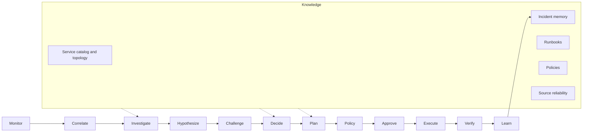
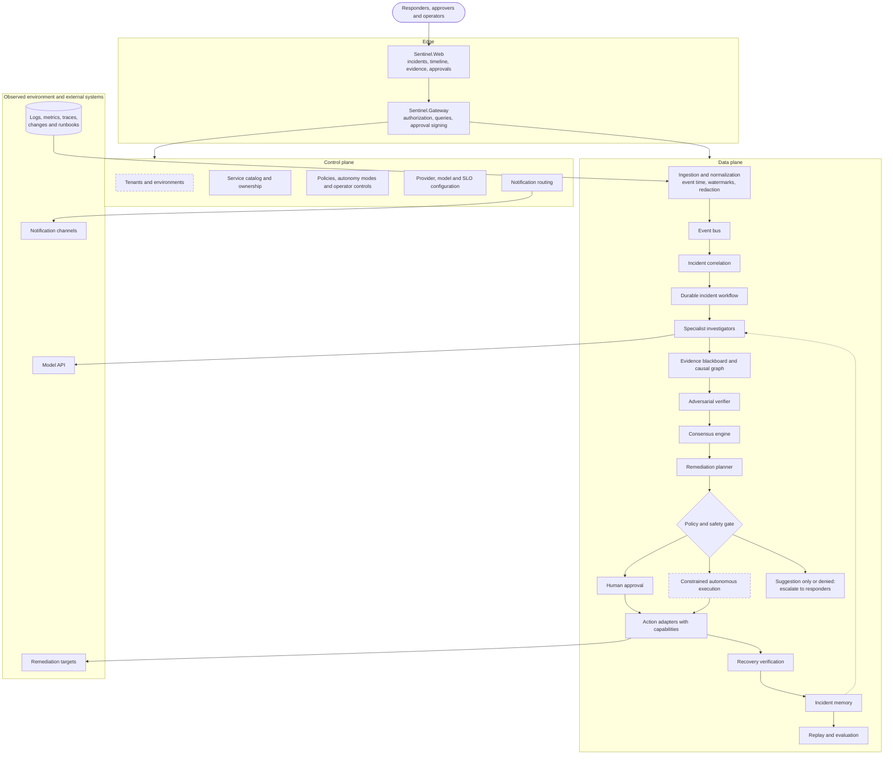
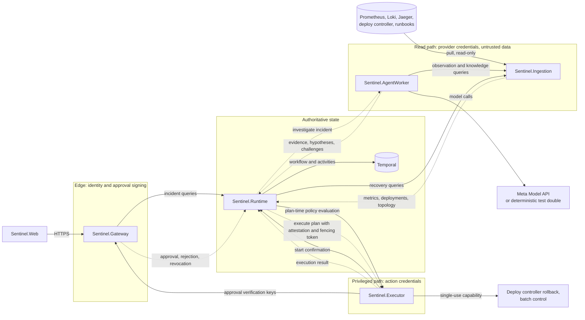
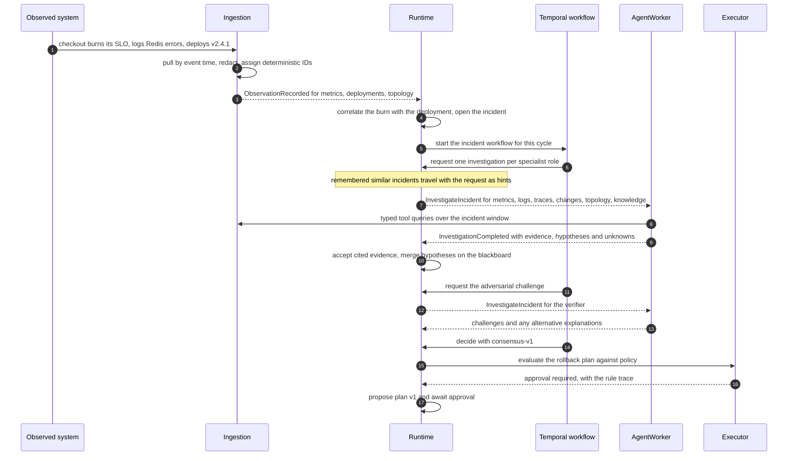
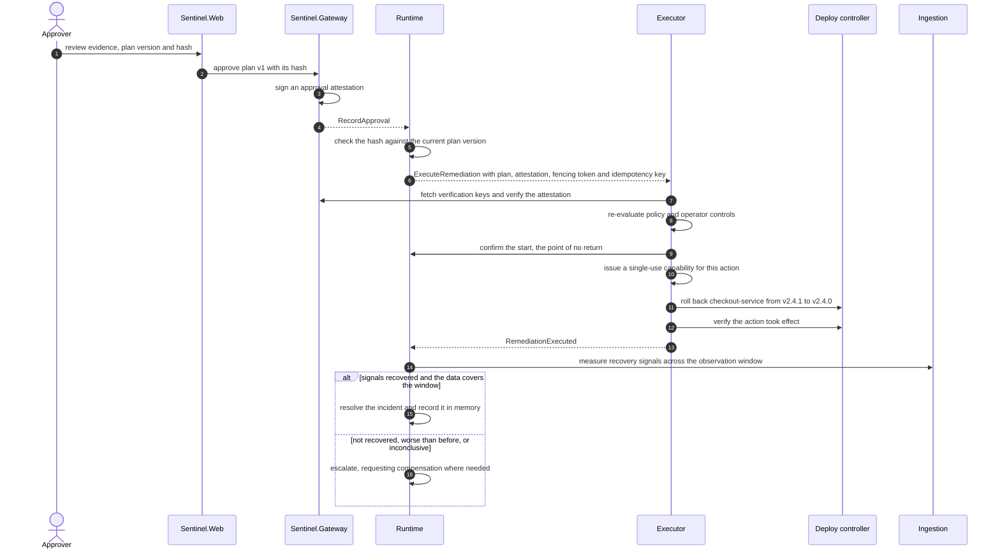
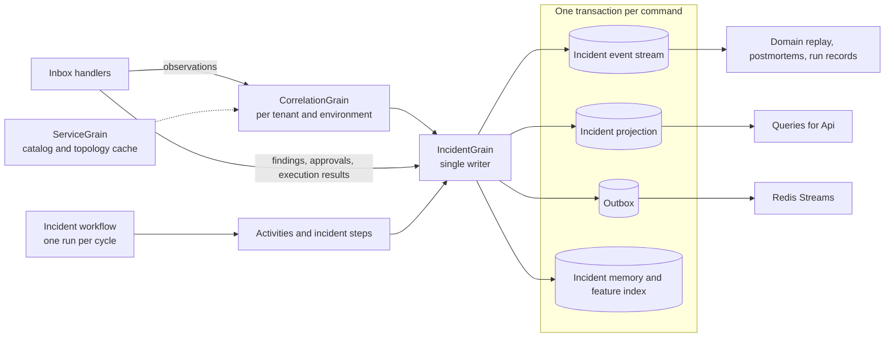
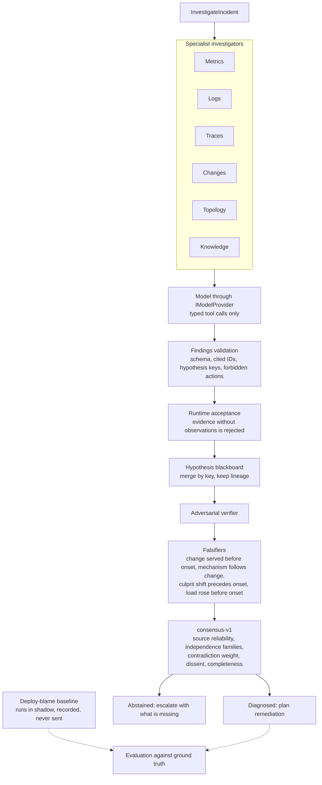
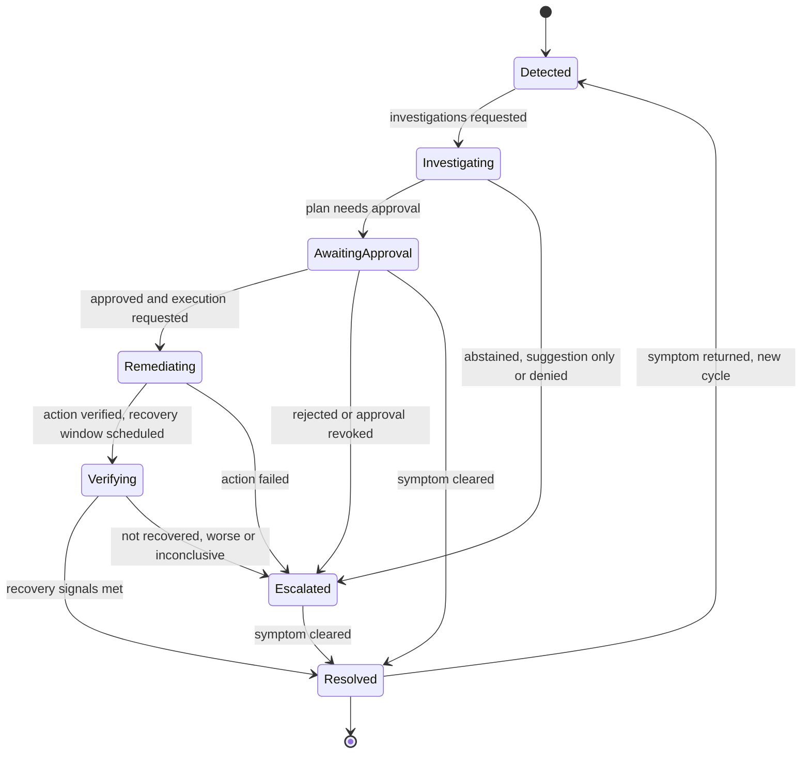
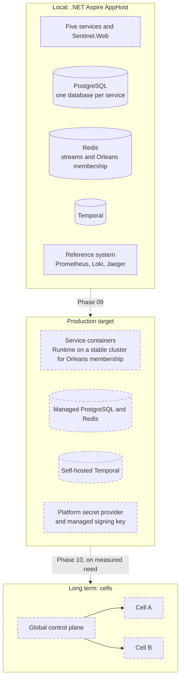

# Sentinel

## Purpose

Sentinel is an AI-native incident investigation and recovery platform for distributed systems. It correlates telemetry into incidents, sends specialist investigators after the evidence, challenges every hypothesis before it can lead, proposes remediation that policy must permit and a person must approve, and only calls an incident resolved when telemetry shows recovery.

Sentinel is built against a controlled reference system with three failure scenarios. In the golden scenario a deployment leaks Redis connections: Sentinel must blame the deployment, reject the competing explanations, propose a rollback, wait for approval, execute it through a constrained adapter and verify recovery. In two confounder scenarios the most recent deployment is innocent, and a deterministic deploy-blame baseline runs beside Sentinel on every investigation. Sentinel has to beat the baseline, not just solve the golden case.

Non-goals for the first milestone are broad vendor coverage, unrestricted autonomous production access, a general-purpose ITSM tool, arbitrary command execution by a model, and custom infrastructure such as databases or message brokers.

## Project type

`microservices`

## Status

Sentinel runs end to end on a developer machine. There is no hosted deployment and no CI pipeline yet; both are deliberate for now.

Status by phase, with the evidence for each claim and the exit criteria still open, lives only in the [phase status ledger](docs/implementation/phase-status.md); this README does not repeat it. In outline, Phases 00 to 08 all have working implementations on the golden path, and Phases 09 and 10 have not started. Two gaps cut across several phases: there is no recorded outcome for the golden scenario `S1`, and the live model has not yet produced findings.

Models run through Sentinel's own model interface. The default provider is a deterministic test double, so every local run and test is reproducible; the Meta model adapter is used only when it is configured with credentials (see [Getting started](#getting-started)).

## Architecture summary

Sentinel is designed as an autonomic loop split into a **control plane**, which holds configuration and governance, and a **data plane**, which runs incidents. Five coarse-grained backend services and one web app carry that design and establish its trust, scaling and failure boundaries from the start ([ADR-001](docs/decisions/ADR-001-production-first-service-topology.md)). A few principles shape every part of it:

- **Vendor neutrality.** Providers are translated into canonical observations at the edge; nothing downstream sees a vendor payload.
- **Verifiable AI.** Models propose evidence and hypotheses through typed tools and validated structured output. A conclusion counts only if it cites observations the tools actually returned, and it must survive an adversarial challenge.
- **Human-controlled autonomy.** Agents never hold credentials or execute anything. Every action is a typed plan that passes policy, approval when required, a single-use capability and recovery verification.
- **Event-sourced truth.** Each incident is an append-only event stream; every view, timeline, postmortem and replay is derived from it.
- **Failure-aware by default.** Outbox and inbox delivery, idempotent commands, fencing tokens, bounded queries and explicit partial-data handling are part of the design, not afterthoughts.

The full design is in the [architecture document](docs/architecture/architecture.md) and the [architecture overview](docs/architecture/overview.md). In the diagrams below, solid boxes are implemented and dashed boxes are planned.

### The autonomic loop

Sentinel extends the classic monitor-analyze-plan-execute loop with explicit hypothesis, challenge, policy and verification steps. Knowledge spans the whole loop and grows with every incident.



### Control plane and data plane

The control plane is low-volume and strongly consistent: who the tenants are, which services exist and who owns them, which providers and models are configured, and what policy permits. The data plane is high-volume and bursty: it turns telemetry into incidents and incidents into verified outcomes.



Tenant and environment identity already scopes every observation, incident and query, and the Gateway routes live events to webhook and log channels by event, severity and tenant. Tenant administration and constrained autonomous execution are planned. The Gateway's control-plane API reads, updates and audits each service's configuration, including the service catalog, policy, operator controls, providers, models and SLO rules, with version history, and the web app has a page for each, plus a manual override that takes one kind of action out of service. Incident memory, replay and evaluation are being built in Phase 07.

### Service topology and trust boundaries

Each service owns one concern, one database and one set of credentials. Services integrate only through versioned contracts: events over Redis Streams, written through a transactional outbox and deduplicated by an inbox, and bounded request/response calls. None reads another's tables ([ADR-007](docs/decisions/ADR-007-cross-service-code-and-provider-access.md), [ADR-008](docs/decisions/ADR-008-event-transport.md), [ADR-009](docs/decisions/ADR-009-persistence-baseline.md)).



Solid arrows are synchronous calls; dotted arrows are events on Redis Streams.

| Service | Owns | Holds credentials for | Publishes | Consumes |
| --- | --- | --- | --- | --- |
| `Sentinel.Gateway` | Approvals, signing keys, the external API | Approval signing (local key today, managed key in production) | `RecordApproval`, `RecordRejection`, `RecordRevocation` | None |
| `Sentinel.Ingestion` | Source checkpoints, watermarks, canonical observations | Telemetry, change and knowledge providers | `ObservationRecorded` for metrics, deployments and topology ([ADR-018](docs/decisions/ADR-018-observation-publication-scope.md)) | None |
| `Sentinel.Runtime` | Incident streams, projections, correlation state, incident memory | None | `InvestigateIncident`, `ExecuteRemediation`, incident lifecycle events | Observations, findings, approvals, execution results |
| `Sentinel.AgentWorker` | Agent executions, tool calls, captured inputs, replays | The model API | `InvestigationCompleted` | `InvestigateIncident` |
| `Sentinel.Executor` | Policy, operator controls, capabilities, executions | Remediation targets | `RemediationExecuted` | `ExecuteRemediation` |

The trust rules behind the zones:

- Telemetry, logs and runbooks are untrusted data, never instructions. They are redacted in Ingestion before they are stored or shown to a model, and a runbook that addresses "AI agents" is just text.
- Model output is an untrusted proposal until it passes schema validation, cites only observations its own tool calls returned, and is accepted by Runtime.
- Only Ingestion holds provider credentials and only Executor holds action credentials. AgentWorker reads through Ingestion's query contract and can change nothing.
- Api signs approvals; Executor verifies them; Runtime relays them but cannot create them. Approvals go to Runtime, never straight to Executor ([ADR-006](docs/decisions/ADR-006-remediation-control-path.md)).
- Recovery is decided from the expected signals, not from an adapter's success response.

### How an incident moves through Sentinel

Detection, investigation and decision, using the golden scenario:



Approval, execution and verification follow the remediation control path ([ADR-006](docs/decisions/ADR-006-remediation-control-path.md)):



### Inside Runtime

Runtime keeps the incident's truth in its event stream ([ADR-004](docs/decisions/ADR-004-runtime-state-ownership.md)). One Orleans grain per incident is the only writer, so commands for one incident never interleave; a Temporal workflow drives the incident's steps and sees only IDs and small summaries, never telemetry or model output ([ADR-005](docs/decisions/ADR-005-durable-workflow-engine.md), [ADR-017](docs/decisions/ADR-017-runtime-actor-and-workflow-hosting.md)).



Every command is idempotent and deterministic, so a retried workflow step either appends nothing or is refused by the aggregate's invariants. Projections, timelines, postmortems and replays are all rebuilt from the stream; a domain replay re-runs each recorded decision on the stream prefix it was made from and reports any difference.

### Investigation and consensus

Investigation is a fan-out of specialists, each limited to its own tools, followed by a deliberate attempt to prove the leading explanations wrong.



A falsified hypothesis cannot lead, copies of one signal count once, partial data weighs less, and Sentinel abstains below the confidence threshold instead of guessing. Every decision records its algorithm version, the settings it used and a hash of its inputs, so it can be replayed exactly. Every agent execution records its model, prompt version, tool calls and the provider responses it received, so it can be replayed without calling a live provider.

### Incident lifecycle



A later observation can also supersede a decision and return the incident to `Investigating`; the superseded decision stays in the history.

### Deployment topology

Locally, the .NET Aspire AppHost runs everything: the five services, the web app, PostgreSQL with one database per service, the messaging Redis, Temporal and the whole reference system with its observability stack ([ADR-010](docs/decisions/ADR-010-local-orchestration.md)). Tokens between the reference system and Sentinel are generated Aspire parameters kept in user secrets.

The production target keeps the same five deployables and adds what local development does not need. Only the local topology exists today.



### Cross-cutting concerns

- **Reliability.** Transactional outbox and inbox with dead-letter handling, idempotency keys, fencing tokens on execution, bounded and prioritized ingestion with backoff, a query bulkhead, and explicit completeness metadata so partial data is never mistaken for an absence of evidence.
- **Observability.** Every service emits OpenTelemetry traces, metrics and logs, with ingestion lag, watermark, model call, token, cost and schema-failure telemetry. The Aspire dashboard shows them locally.
- **Auditability and replay.** Incident streams, agent executions with captured inputs, policy rule traces and signed approvals make every conclusion and action traceable. Replay is designed at four levels: domain, investigation, model reevaluation and system simulation. Phase 07 is building the first three, and the reference system's scenario runner is the first simulation target.
- **Privacy and retention.** Redaction happens before storage, incident memory carries retention, legal-hold and privacy metadata, and purges are run by an operator, a dry run first.
- **Multi-tenancy.** Every observation, incident, memory record and query is scoped by tenant and environment; similar-incident retrieval never crosses tenants.

### Technology choices

| Concern | Choice | Decision |
| --- | --- | --- |
| Backend platform | .NET 10 LTS, ASP.NET Core | [ADR-003](docs/decisions/ADR-003-dotnet-backend-platform.md) |
| Incident state | Event sourcing in PostgreSQL, Microsoft Orleans single writers | [ADR-004](docs/decisions/ADR-004-runtime-state-ownership.md), [ADR-017](docs/decisions/ADR-017-runtime-actor-and-workflow-hosting.md) |
| Durable workflows | Temporal | [ADR-005](docs/decisions/ADR-005-durable-workflow-engine.md) |
| Event transport | Redis Streams with outbox and inbox | [ADR-008](docs/decisions/ADR-008-event-transport.md), [ADR-012](docs/decisions/ADR-012-event-semantics.md) |
| Persistence | PostgreSQL, one database per service | [ADR-009](docs/decisions/ADR-009-persistence-baseline.md) |
| Local orchestration | .NET Aspire | [ADR-010](docs/decisions/ADR-010-local-orchestration.md) |
| Providers and models | Sentinel-owned provider and model interfaces; Meta Model API first, deterministic test double by default | [ADR-014](docs/decisions/ADR-014-provider-abstraction.md), [ADR-015](docs/decisions/ADR-015-model-abstraction.md) |
| Event time | Watermarks and a late-data policy per source | [ADR-016](docs/decisions/ADR-016-event-time-and-late-data.md) |
| Frontend | Next.js, React, TypeScript, Tailwind CSS, shadcn/ui and Radix UI on a governed design system | [ADR-002](docs/decisions/ADR-002-frontend-design-system.md) |

All decisions are indexed in [docs/decisions](docs/decisions/README.md). Still open: the production deployment environment, service-to-service authentication, and real approver identity before Phase 08.

## Repository map

- `apps/Sentinel.Web`: the Next.js frontend and its design system.
- `services/`: `Sentinel.Gateway`, `Sentinel.Ingestion`, `Sentinel.Runtime`, `Sentinel.AgentWorker` and `Sentinel.Executor`, each split into Api, Application, Domain and Infrastructure projects ([composition guide](docs/architecture/application-composition-and-cqrs.md)); tests sit beside each service.
- `packages/`: the only shared code ([ADR-007](docs/decisions/ADR-007-cross-service-code-and-provider-access.md)): `CleanArchitecture.BuildingBlocks` for results, messaging and persistence, `Sentinel.Contracts` for versioned messages, queries and views, and `Sentinel.ServiceDefaults` for hosting defaults. There is no shared domain package.
- `reference-system/`: the system Sentinel is tested against ([ADR-011](docs/decisions/ADR-011-reference-system-location.md)): checkout, order and reporting services, the deploy controller, the observability stack configuration, scenarios `S0` to `S3`, runbooks and the deploy-blame baseline.
- `deploy/local/`: the .NET Aspire AppHost that runs everything locally and the end-to-end suites.
- `docs/`: architecture, decisions, implementation phases, business and API contracts.
- `artifacts/`: generated diagrams and reports, with their sources.
- `scripts/`: repeatable build, test and lint automation.
- `.agents/`, `.codex/`, `.claude/`: project steering, commit guidelines and agent adapters.
- `Sentinel.slnx`, `global.json`, `Directory.Build.props` and `Directory.Packages.props` pin the SDK, analyzers and package versions for every project.

## Getting started

Prerequisites:

- .NET SDK 10.0.302 or a later 10.0.3xx patch, as pinned in `global.json`.
- Node.js 24 LTS for `Sentinel.Web`, as pinned in `apps/Sentinel.Web/.nvmrc`.
- Docker with CLI and engine 25.0 or newer, running. Aspire 13.6 rejects older versions. The AppHost starts PostgreSQL, Redis, Temporal, Prometheus, Loki and Jaeger as containers.

From this directory:

1. Run `setup` once to restore .NET packages and install the web app's dependencies.
2. Run `run` to start all five services, the web app and the reference system. The Aspire dashboard opens with every resource's logs, traces, metrics and health.
3. Start a scenario from the `scenario-runner` resource's commands in the dashboard (`Run S1` is the golden scenario), then follow the incident in Sentinel.Web.

Local sign-in uses synthetic development identities such as `responder@example.test`, which exist only in the development configuration. Tokens between the reference system and Sentinel are generated Aspire parameters kept in the AppHost's user secrets; none is stored in the repository.

To investigate with Meta models instead of the test double, put the API key in AgentWorker's user secrets as `Model:Meta:ApiKey`, set `Model:Provider` to a Meta profile, and route roles with `Model:Routing:<role>`. Never commit model credentials. AgentWorker's [appsettings.json](services/Sentinel.AgentWorker/src/Sentinel.AgentWorker.Api/appsettings.json) defines the profiles, each a model with its reasoning effort, reasoning-token allowance and list prices:

| Profile | Model | Effort | Suggested roles |
| --- | --- | --- | --- |
| `meta` | `muse-spark-1.3` | medium | metrics, logs, knowledge |
| `meta-deep` | `muse-spark-1.3` | high | traces, topology, changes |
| `meta-wonder` | `muse-wonder-1.0` | high | None by default. It costs about three to five times as much, so route `changes`, where a misleading deployment is decided, to it for demonstrations. |
| `meta-contributor` | `muse-spark-1.3-contributor` | medium | None by default. Meta may train on prompts and outputs in Contributor mode, so use it only with synthetic data. |

Findings are requested with the findings JSON Schema alongside the tools, so the API shapes the answer, and reasoning gets its own share of the output limit because it counts against it. Every model call is costed at its profile's price and recorded with the execution. `Model:Budget` caps the estimated spend of priced models, by default at $100 in total and $15 a day, and `muse-wonder-1.0` at $5 a day of its own. At a cap, investigations abstain and say why. An incident's six specialists run side by side (`AgentWorker:InvestigationConcurrency`, default 6).

## Commands

| Task | Command |
| --- | --- |
| Setup | `powershell -NoProfile -File scripts/check.ps1 -Task setup` |
| Run | `dotnet run --project deploy/local/Sentinel.AppHost` |
| Test | `powershell -NoProfile -File scripts/check.ps1 -Task test` |
| Lint | `powershell -NoProfile -File scripts/check.ps1 -Task lint` |
| Build | `powershell -NoProfile -File scripts/check.ps1 -Task build` |

Each task covers the .NET solution and `Sentinel.Web` and stops at the first failure; on Linux or macOS run the same script with `pwsh`. `build`, `test` and `lint` need no containers, except for the integration tests that start their own with Testcontainers. The .NET build treats analyzer and code-style warnings as errors, so `build` also enforces C# style. `lint` checks C# whitespace, runs ESLint with the design-system rules and typechecks the web app. [Sentinel.Web's README](apps/Sentinel.Web/README.md) lists its own commands.

The end-to-end suites start the whole system and drive real scenarios, so they take around half an hour:

```text
dotnet test deploy/local/Sentinel.EndToEnd.Tests --filter "FullyQualifiedName~GoldenPathTests"
```

They always investigate with the deterministic test double, even when Meta models are configured and routed in user secrets, so their results are reproducible and cost nothing. To run them live, set `SENTINEL_E2E_MODEL_PROVIDER=configured` to use AgentWorker's own configuration with its routing, or name one profile such as `meta` for every role. Live runs are slower, cost real money, and their assertions on the diagnosis depend on the model.

Keep this table synchronized with `PROJECT.json` and the scripts.

## Documentation

- [Documentation index](docs/README.md)
- [Architecture](docs/architecture/README.md): the [full architecture](docs/architecture/architecture.md), the [overview](docs/architecture/overview.md), the [product architecture diagram](docs/architecture/assets/sentinel-product-architecture.png) and the [frontend design system](docs/architecture/frontend-design-system.md)
- [Phase-wise implementation plan](docs/implementation/README.md) and the [phase status ledger](docs/implementation/phase-status.md)
- [Architecture decisions](docs/decisions/README.md)
- [Business and API contracts](docs/business-contracts/README.md)
- [Runbooks](docs/runbooks/README.md): emergency stop, models and spend, dead letters and projection rebuild; more arrive with the Phase 09 deployment definition.
- Generated diagrams and reports live under `artifacts/` with their sources and provenance, for example the [walking-skeleton comparison report](artifacts/reports/walking-skeleton/comparison.md).

## Verification

Run `build`, `test` and `lint` before completing a change. Each service's architecture tests enforce layer direction and reject dependencies on other services, and the end-to-end suites keep the golden path passing across real process boundaries. Structural changes must also pass the workspace project validator. Tests stay with the service or package they verify.

## Related learning

No learning-topic links have been established yet.
