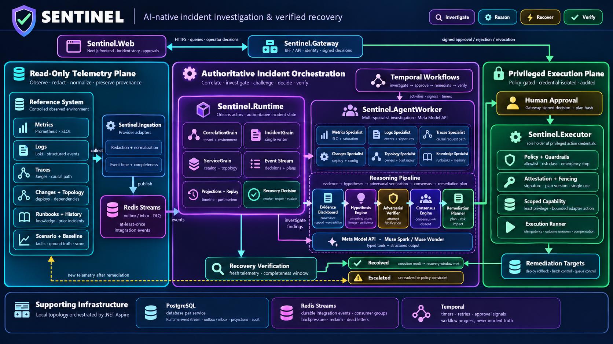
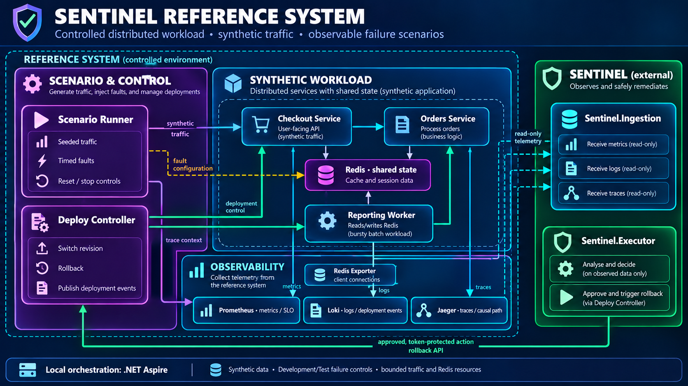

# Architecture

Two diagrams give the picture at a glance:

- [Sentinel system architecture](assets/sentinel-system-architecture.png): the read-only telemetry plane, authoritative incident orchestration in Runtime and AgentWorker with the reasoning pipeline, the privileged execution plane behind human approval, recovery verification and the supporting infrastructure.
- [Reference system architecture](assets/reference-system-architecture.png): the controlled workload Sentinel observes, the scenario runner and deploy controller that drive it, its telemetry backends, and the read-only and approved-action boundaries to Sentinel.

Both are presentation images without an editable source. When the architecture changes, the Mermaid diagrams in the [architecture document](architecture.md) and the [README](../../README.md) are updated first, and the images are redrawn from them.





## Documents

- [Full Sentinel product architecture](architecture.md)
- [Concise architecture overview](overview.md)
- [Frontend design system](frontend-design-system.md): stack, rules, token model and the 2026-10-30 gap assessment; deepened by [Phase E02](../implementation/phase-e02-frontend-design-system-depth.md)
- [Application composition and CQRS guide](application-composition-and-cqrs.md)
- [Threat model](threat-model.md): trust boundaries, mitigations with evidence, open risks and the status of the 2026-10-29 review findings
- [Service-level objectives](service-level-objectives.md): what Sentinel itself promises, the metric behind each promise and what to do when a budget is spent
- [AWS reference environment](aws-reference-environment.md): current reference-system topology, two scenario tracks, hybrid telemetry path, local AWS integration boundaries, scenario catalogue, fidelity model and staged adoption gates; delivered by [Phase E01](../implementation/phase-e01-aws-reference-environment.md)
- [Demonstration depth](demonstration-depth.md): making Sentinel's judgement visible live, manipulation resistance, self-correction, recurrence, the damage avoided and live investigation, with their boundaries; delivered by [Phase E03](../implementation/phase-e03-demonstration-depth.md)
- [Judge mode](judge-mode.md): one incident as a guided, source-linked story over the records the Gateway already serves, in captured and live modes, with the platform concerns deferred to their own decisions; delivered by [Phase E04](../implementation/phase-e04-judge-mode.md)
- [Model roles beyond the specialists](model-roles.md): an escalation investigator, an artifact investigator and a visual synthetic monitor, each with one responsibility inside the existing evidence pipeline, and the uses ruled out; decided by [ADR-024](../decisions/ADR-024-model-roles.md). The escalation investigator is delivered by [Phase E05](../implementation/phase-e05-escalation-investigator.md); [Phase E06](../implementation/phase-e06-incident-artifacts.md) and [Phase E07](../implementation/phase-e07-visual-synthetic-monitor.md) are deferred
- [Phase-wise implementation plan](../implementation/README.md)
- [Architecture-to-phase coverage matrix](../implementation/coverage-matrix.md)
- [Phase status ledger](../implementation/phase-status.md)

## Earlier diagrams

The first product architecture diagram, from the design phase, is kept with its editable source: the [PNG](assets/sentinel-product-architecture.png), the [SVG](assets/sentinel-product-architecture.svg) and an [interactive version](../../artifacts/archify/sentinel-system-architecture-20261021-001526/sentinel-system-architecture.html). Regenerate the PNG after editing the SVG with:

```powershell
node scripts/render-architecture.mjs
```

Set `CHROMIUM_EXECUTABLE` if Chrome or Edge is not installed in a standard Windows location.

## What this section maintains

The current architectural model:

- System context and users
- Runtime containers and deployable units
- Components and dependency direction
- Data ownership and data flows
- External integrations and trust boundaries
- Deployment topology and failure domains
- Cross-cutting concerns such as security, observability, reliability, and performance

Link generated visualizations from `../../artifacts/archify/` and `../../artifacts/graphify/`. Keep diagram source and regeneration instructions with the generated artifact.
