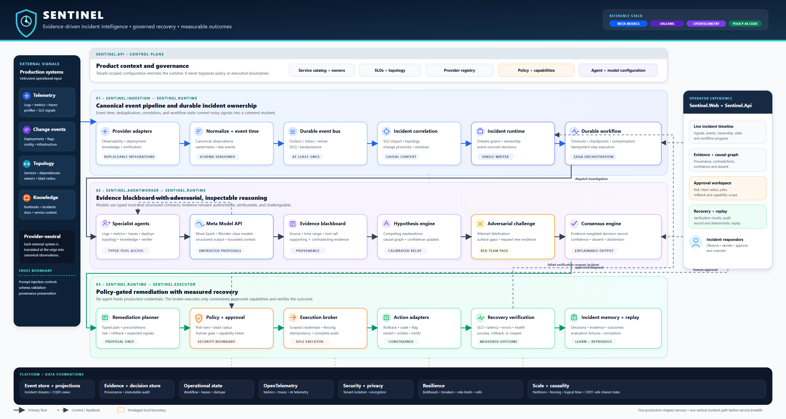

# Architecture

- [Static product architecture diagram (PNG)](assets/sentinel-product-architecture.png)
- [Editable product architecture source (SVG)](assets/sentinel-product-architecture.svg)
- [Full Sentinel product architecture](architecture.md)
- [Concise architecture overview](overview.md)
- [Frontend design system](frontend-design-system.md)
- [Application composition and CQRS guide](application-composition-and-cqrs.md)
- [Threat model](threat-model.md): trust boundaries, mitigations with evidence, open risks and the status of the 2026-10-29 review findings
- [Phase-wise implementation plan](../implementation/README.md)
- [Architecture-to-phase coverage matrix](../implementation/coverage-matrix.md)
- [Phase status ledger](../implementation/phase-status.md)
- [Interactive Sentinel product architecture diagram](../../artifacts/archify/sentinel-system-architecture-20261021-001526/sentinel-system-architecture.html)



Regenerate the PNG after editing the SVG with:

```powershell
node scripts/render-architecture.mjs
```

Set `CHROMIUM_EXECUTABLE` if Chrome or Edge is not installed in a standard Windows location.

Maintain the current architectural model here:

- System context and users
- Runtime containers and deployable units
- Components and dependency direction
- Data ownership and data flows
- External integrations and trust boundaries
- Deployment topology and failure domains
- Cross-cutting concerns such as security, observability, reliability, and performance

Link generated visualizations from `../../artifacts/archify/` and `../../artifacts/graphify/`. Keep diagram source and regeneration instructions with the generated artifact.
