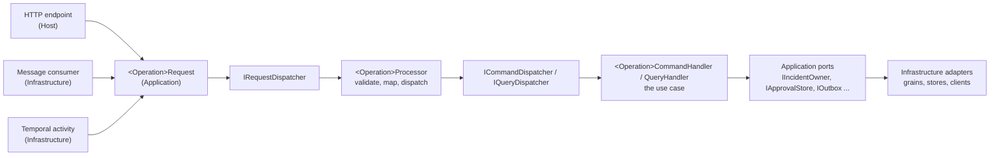

# Application composition and CQRS guide

## Status and purpose

This is the maintained target design for how a Sentinel service is composed inside its four projects: where a request enters, how it becomes a command or query, which layer registers what, how files and types are organised, and which rules are enforced by tests and analyzers. It changes structure, not Sentinel's topology, contracts, trust boundaries or runtime behaviour.

The design takes its patterns from two reference projects and adapts them to decisions Sentinel has already made:

- `C:\Users\ingle\OneDrive\cleanarchitecure` (the single-service template): layer-owned dependency modules composed in a fixed order, the processor seam between transport and use case, result-to-problem mapping at the edge.
- `C:\Users\ingle\OneDrive\projects\distributed-job-engine` (JobService): feature folders per operation, one interface per abstraction file, domain error catalogues, architecture tests, application-owned diagnostics.

The corresponding decision is [ADR-020](../decisions/ADR-020-application-composition-and-cqrs.md). Sections marked **Current** describe the repository on 2026-10-29; everything else is the target.

## Why this refactor is needed

**Current.** Sentinel's service boundaries are right and its building blocks are capable, but inside each service the composition has drifted:

- Every host calls `AddBuildingBlocks` itself and then registers messaging, so the Application layer does not own its own handlers and validators.
- Every Infrastructure registration method also registers Application services. Runtime's registers fourteen Application types; Api's registers its three application services beside its HTTP clients.
- `Program.cs` files mix composition with route structure and use-case orchestration. Api's is about 210 lines and maps twenty-seven endpoints inline; Runtime's maps sixteen.
- Types are clubbed by convenience rather than by ownership. Api's `ApprovalService.cs` holds three interfaces, five records, an options class, the service and an error catalogue. Api's `ApiInfrastructure.cs` holds the registration method plus thirteen clients, stores and options. Runtime's `Ports.cs` holds fourteen types across six concerns. Runtime's `IncidentCommands.cs` holds twenty-five records, `IncidentEvents.cs` twenty-two, `IncidentModel.cs` eighteen.
- Use cases are procedural service classes (`ApprovalService`, `ExecutionService`, `RemediationControlService`, `ControlPlaneService`) called directly from endpoints and message consumers. The CQRS package exists but nothing dispatches through it.
- Message consumers live in Infrastructure beside HTTP clients and call application services directly, so the inbound path for a message differs from the inbound path for an HTTP request.

The result is that a reader cannot answer, for any feature, the five questions below without opening several large files. The target makes each answer a file name.

1. Where does the request enter? An endpoint or consumer in Host or Infrastructure, one file per capability.
2. Which application type represents it? `<Operation>Request` in the operation's feature folder.
3. Which processor accepts it and which command or query does it become? `<Operation>Processor`, `<Operation>Command` or `<Operation>Query`, same folder.
4. Which handler owns the use case and which ports does it need? `<Operation>CommandHandler`; its constructor lists the ports, one interface per file under `Abstractions/`.
5. Which layer registers the implementation? The owning layer's dependency module.

## Request flow

Every inbound request, whether HTTP or an integration message, follows one path:



| Step | Owner | Responsibility | Must not |
| --- | --- | --- | --- |
| Endpoint or consumer | Host (HTTP), Infrastructure (messages, activities) | Authenticate and authorize, bind transport input and principal into one `<Operation>Request`, send it, map the `Result` to a response or acknowledgement | Touch ports, stores or domain types; contain branching on business state |
| Request | Application | An immutable record of what the caller asked for, in application terms, implementing `IRequest<TResult>` | Carry transport types such as `HttpContext`, `ClaimsPrincipal` or message envelopes |
| Processor | Application | Validate the request with its FluentValidation validator, map it to exactly one command or query, dispatch it, return the result | Call ports, load aggregates, publish, or dispatch more than one message |
| Command or query | Application | The use case's input, named for the business action | Implement any `Sentinel.Contracts` type or be sent across a service boundary |
| Handler | Application | The use case: load through ports, call domain behaviour, persist, enqueue through the outbox, return `Result` | Call another handler; reach Infrastructure types; perform HTTP |
| Ports | Application `Abstractions/` | One interface per external need | Expose SDK types |
| Adapters | Infrastructure | Implement ports with grains, PostgreSQL, Redis Streams, HTTP clients, Temporal | Register Application types |

The processor is the seam the reference template calls the "processor" and the job engine calls the same. It exists so that an HTTP endpoint and a message consumer for the same use case are two thin adapters over one application entry point, and so that validation happens once, where untrusted input becomes an application message. The cost is one extra type per operation and a request record that often mirrors its command. That cost is accepted uniformly, for queries too, because a path that is sometimes two hops and sometimes three is harder to read than one that is always three.

### Validation placement

Validation runs once per inbound request, in the processor, against the `<Operation>Request`. A command validator is needed only when a command can be built without passing through a processor, which should be rare once consumers and activities also send requests. Domain invariants stay in Domain and return `Result` failures; validators check shape, not business rules.

### Results at the edge

Handlers return `Result` or `Result<T>` with typed `Error`s from a per-capability error catalogue (`ApprovalErrors`, `PolicyErrors`). Host maps `Result` to HTTP once, in one place, the way the reference template's `ApiController.Match` does: `Ok`, `Accepted`, `NoContent`, `NotFound`, `Conflict` or a problem document chosen from `ErrorType`. Endpoints do not inspect `IsSuccess` inline. Sentinel's existing `ToProblem` extension is the start of this; it becomes a `Results` helper used by every endpoint.

## Layer-owned dependency modules

Each layer that has services to register owns one dependency module. The Host composes them in a fixed order, so composition is readable in one place and testable as a unit.

| Layer | Module | Registers | Does not register |
| --- | --- | --- | --- |
| Domain | none | Nothing. Domain has no services and no reference to `Microsoft.Extensions.DependencyInjection`; the architecture test that restricts Domain to `BuildingBlocks.Core` and `Sentinel.Contracts.Primitives` enforces this. | |
| Application | `ApplicationDependencyModule` | The building-block pipeline for its own assembly (dispatchers, handlers, processors, validators, decorators) and application services that the scan does not discover | Port implementations, options binding, anything that needs `IConfiguration` |
| Infrastructure | `InfrastructureDependencyModule` | Port implementations, options with validation, data sources, messaging, grains, workflows, HTTP clients, hosted services | Application handlers or services |
| Host | `HostDependencyModule` | Authentication, authorization, OpenAPI, problem details, endpoint filters, anything only the process needs | Application or Infrastructure types |

The module contract is the existing `IDependencyModule` in `CleanArchitecture.BuildingBlocks.Hosting`:

```csharp
public interface IDependencyModule
{
    void RegisterServices(IServiceCollection services, IConfiguration configuration);
}
```

Application modules receive the configuration and ignore it. That asymmetry is accepted so that one interface serves every layer and the composition root can treat modules uniformly.

```csharp
// Sentinel.Api.Application/ApplicationDependencyModule.cs
public sealed class ApplicationDependencyModule : IDependencyModule
{
    public void RegisterServices(IServiceCollection services, IConfiguration configuration) =>
        services.AddBuildingBlocks(AssemblyReference.Assembly);
}

// Sentinel.Api.Infrastructure/InfrastructureDependencyModule.cs
public sealed class InfrastructureDependencyModule : IDependencyModule
{
    public void RegisterServices(IServiceCollection services, IConfiguration configuration)
    {
        services
            .AddApiOptions(configuration)
            .AddApprovalSigning()
            .AddApiPersistence()
            .AddServiceClients(configuration)
            .AddLiveUpdates(configuration);
    }
}

// Sentinel.Api.Host/DependencyContainer.cs
internal sealed class DependencyContainer
{
    private static readonly IDependencyModule[] Modules =
    [
        new Application.ApplicationDependencyModule(),
        new Infrastructure.InfrastructureDependencyModule(),
        new HostDependencyModule()
    ];

    public static void RegisterAll(IServiceCollection services, IConfiguration configuration)
    {
        foreach (IDependencyModule module in Modules)
        {
            module.RegisterServices(services, configuration);
        }
    }
}
```

Order is Application, then Infrastructure, then Host: inner layers first, so an outer layer's `TryAdd` or decoration sees the inner registrations it refines. The reference template registers Infrastructure first; Sentinel reverses it because its infrastructure decorates and replaces application defaults (test doubles, in-process owners), never the other way round.

Infrastructure modules split into private, capability-named methods (`AddApiPersistence`, `AddServiceClients`) each in its own file under `Infrastructure/DependencyInjection/`. The public module stays a short list of calls.

`Program.cs` becomes a process outline:

```csharp
WebApplicationBuilder builder = WebApplication.CreateBuilder(args);

builder.AddServiceDefaults();
builder.AddSentinelMessaging("api").RegisterApiMessages();
DependencyContainer.RegisterAll(builder.Services, builder.Configuration);

await using WebApplication app = builder.Build();

app.UseAuthentication();
app.UseAuthorization();
app.MapDefaultEndpoints();
app.MapOperatorEndpoints();
app.MapIncidentEndpoints();
app.MapApprovalEndpoints();
app.MapPostmortemEndpoints();
app.MapLiveEndpoints();
app.MapAdminEndpoints();

await app.RunAsync();
```

Message registration (`Produces<>` and `Consumes<,>`) moves from `Program.cs` into one `RegisterApiMessages` extension in Infrastructure, beside the consumers it names, because the host should not know which contract types the service exchanges.

### Package reference consequence

`AddBuildingBlocks` and `IDependencyModule` live in `CleanArchitecture.BuildingBlocks.Hosting`, so an Application module must reference that package. The [building-blocks evolution plan](../implementation/building-blocks-evolution.md) now allows this for registration only, and Hosting continues to carry no infrastructure packages and no ASP.NET Core. The alternative, moving registration into the Application package, would give the Application package a FluentValidation and dependency-injection dependency it does not otherwise need, which is the same trade in a different place. The package-side work (the processor types, the module composer, and splitting the package's own clubbed files) is the evolution plan's Stage E2 and precedes the first service slice.

## Target folder structure

Apply the same shape independently in each service. Create a folder when its first real type exists.

```text
services/Sentinel.<Service>/src/
├── Sentinel.<Service>.Domain/
│   ├── <Aggregate>/
│   │   ├── <Aggregate>.cs
│   │   ├── <ValueObject>.cs            one per file
│   │   ├── <Aggregate>Errors.cs        the error catalogue for the aggregate
│   │   └── Events/
│   │       └── <Something>Happened.cs  one per file
│   └── AssemblyReference.cs
│
├── Sentinel.<Service>.Application/
│   ├── Abstractions/
│   │   ├── Persistence/  I<Thing>Store.cs
│   │   ├── Messaging/    outbound ports beyond the building-block IOutbox
│   │   ├── Providers/    I<External>Queries.cs, I<External>Client.cs
│   │   ├── Runtime/      IIncidentOwner.cs, IIncidentWorkflows.cs
│   │   └── Security/     IApprovalSigner.cs, IApprovalKeyResolver.cs
│   ├── Features/
│   │   └── <Capability>/
│   │       ├── <Operation>/
│   │       │   ├── <Operation>Request.cs
│   │       │   ├── <Operation>RequestValidator.cs
│   │       │   ├── <Operation>Processor.cs
│   │       │   ├── <Operation>Command.cs        or <Operation>Query.cs
│   │       │   ├── <Operation>CommandHandler.cs or <Operation>QueryHandler.cs
│   │       │   └── <Operation>Response.cs       when the result is a read model
│   │       ├── <Capability>Errors.cs
│   │       └── Services/                        only shared application policy
│   ├── Options/          <Capability>Options.cs, bound by Infrastructure
│   ├── ApplicationDependencyModule.cs
│   └── AssemblyReference.cs
│
├── Sentinel.<Service>.Infrastructure/
│   ├── DependencyInjection/
│   │   ├── InfrastructureDependencyModule.cs
│   │   └── <Capability>Registration.cs          the private Add* methods
│   ├── Messaging/
│   │   ├── <Service>Messages.cs                 Produces/Consumes registration
│   │   └── Consumers/<Contract>Consumer.cs      one per contract, sends a request
│   ├── Persistence/
│   │   ├── <Service>Schema.cs
│   │   └── Postgres<Thing>Store.cs              one per port
│   ├── Clients/          <Peer><Purpose>Client.cs, one per port
│   ├── Grains/, Workflows/, Providers/, Models/  as the service needs
│   └── AssemblyReference.cs
│
└── Sentinel.<Service>.Host/
    ├── Endpoints/
    │   ├── <Capability>Endpoints.cs             MapXEndpoints extension
    │   └── Routes.cs                            route roots for this host
    ├── Contracts/
    │   ├── <Operation>Body.cs                   transport bodies, one per file
    │   └── ...
    ├── Results.cs                               Result to HTTP mapping
    ├── DependencyContainer.cs
    ├── HostDependencyModule.cs
    └── Program.cs
```

Tests mirror the structure: `Features/Approvals/ApprovePlan/ApprovePlanCommandHandlerTests.cs`, as the job engine does.

## One type per file

A file contains one top-level type and is named after it. This is the rule the user review asked for, it is what both reference projects do, and it is what makes the five questions above answerable from a file listing.

- Nested private types, and a private record used only by the file's type, may stay in the file.
- A closed polymorphic hierarchy keeps its base type in one file and each derived type in its own file in a folder named for the base: `Incidents/Commands/IncidentCommand.cs`, `Incidents/Commands/OpenIncidentCommand.cs`. The `JsonDerivedType` attributes remain on the base.
- Enums get their own file unless they are nested in the only type that uses them.
- Extension-method classes are one per file and named for what they extend or do.

Enforce it with analyzers rather than review. Add `StyleCop.Analyzers` to `Directory.Packages.props` and enable only two rules in `.editorconfig`: `SA1402` (file may only contain a single type) and `SA1649` (file name must match the first type name), with every other StyleCop rule set to `none`. Introduce them at `warning` severity with a suppression file for the files awaiting migration, and raise to `error` when the migration finishes. Doing this before the split would fail the build on day one.

## Interface placement

Interfaces live in the layer that needs them, one per file, grouped by the kind of dependency they abstract.

| Interface kind | Location | Examples today |
| --- | --- | --- |
| Persistence a use case needs | `Application/Abstractions/Persistence` | `IIncidentStore`, `ICorrelationStore`, `IApprovalStore`, `IExecutionStore`, `IPolicyStore` |
| Peer-service access | `Application/Abstractions/Providers` | `IObservationQueries`, `IPolicyEvaluator`, `IRuntimeIncidents`, `IStartConfirmation` |
| Runtime coordination | `Application/Abstractions/Runtime` | `IIncidentOwner`, `ICorrelationPartitions`, `IIncidentWorkflows`, `IServiceCatalog` |
| Signing and keys | `Application/Abstractions/Security` | `IApprovalSigner`, `IApprovalKeyResolver` |
| Privileged adapters | `Application/Abstractions/Remediation` | `IRemediationAdapter` |
| Telemetry the application emits | `Application/Abstractions/Diagnostics` | `IIngestionMetrics` |
| Implementation detail | Beside its implementation, `internal` | a Redis codec used by one adapter |
| Transport concern | Host | endpoint filter, result mapper |

An interface earns its existence by crossing a layer or by being a substitution seam a test uses. A concrete internal class with no second implementation and no boundary crossing stays concrete.

## Message consumers

**Current.** Consumers implement `IIntegrationMessageHandler<T>` in Infrastructure files beside HTTP clients and call application services directly.

Target: one consumer class per contract under `Infrastructure/Messaging/Consumers/`, each a five-line adapter that maps the contract to a `<Operation>Request` and sends it through `IRequestDispatcher`. The same processor and handler then serve HTTP and messages. Consumers stay in Infrastructure because the building-block consumer contract lives there and because the inbox and unit of work are infrastructure concerns.

Integration contracts in `Sentinel.Contracts` never implement `IRequest`, `ICommand` or `IQuery`. The consumer maps.

## Sentinel-specific boundaries

CQRS is the application pattern. It does not replace the actor and workflow models.

- **Orleans.** `IncidentGrain` remains the single writer. A Runtime command handler validates and coordinates, then sends an `IncidentCommand` through `IIncidentOwner`. `IncidentCommand` is the aggregate-level command set serialized to the grain; `ICommand` is the in-process application message. They are different things with different lifetimes, and renaming one to avoid the shared word is not worth the churn. The namespaces `Application.Incidents.Commands` (aggregate) and `Application.Features.*` (application) keep them apart.
- **Temporal.** Workflow code performs no I/O and never touches the container. Activities may send requests through `IRequestDispatcher`; that is the only place an activity reaches the application layer.
- **Long-running operations.** A handler may start a durable operation and return an accepted identifier. It never waits for a workflow to finish.
- **Trust path.** Approval goes Api to Runtime to Executor (ADR-006). Moving the approval use case into a processor and handler changes where the code lives, not who signs, who relays and who verifies.

## Stable strings

Protocol, configuration, route-root, service and telemetry identifiers live as constants beside their owner: `SectionName` on each options class, a `Routes` class per host, message names in `Sentinel.Contracts`, meter and activity-source names beside the instrumentation, roles beside identity. No global constants class. User-facing text, log templates and one-use literals stay where they are.

## Registration and lifetime rules

- Handlers, processors and validators are scoped and registered only through `AddBuildingBlocks` in the Application module. Calling it twice throws, so the Host must not call it.
- Units of work and the stores that join them are scoped. Clocks, options snapshots and immutable caches are singletons. Hosted services create a scope before resolving scoped types.
- Orleans and Temporal registrations keep their frameworks' lifetimes.
- Options bind in Infrastructure with `ValidateOnStart`. Handlers take `IOptions<T>` or a snapshot, never `IConfiguration`.
- The composition test for each host builds the provider with the host's configuration and asserts: every command, query and request resolves exactly one handler or processor; every port has exactly one implementation; no scoped type is captured by a singleton; no hosted service, consumer or outbox worker is registered twice.

## Worked example: approve a plan

The first slice, chosen because it crosses the public edge, Runtime's authority and Executor's privileged boundary.

**Current.** `POST /api/v1/incidents/{id}/plans/{planId}/approve` is an inline lambda in Api's `Program.cs` that builds an `ApprovePlan` record and calls `ApprovalService.ApproveAsync`, a 311-line file that also declares the three ports it uses, the options class, the receipt and the error catalogue. The approval reaches Runtime as `RecordApproval`, consumed by `RecordApprovalHandler` in `RuntimeAdapters.cs`, which calls `RemediationControlService`.

Target, Api:

```text
Sentinel.Api.Host/Endpoints/ApprovalEndpoints.cs
    incident.MapPost("/plans/{planId:guid}/approve",
        (Guid incidentId, Guid planId, ApprovePlanBody body, ClaimsPrincipal user,
         IRequestDispatcher requests, CancellationToken ct) =>
            requests.SendAsync(
                new ApprovePlanRequest(IncidentId.From(incidentId), PlanId.From(planId),
                    body.PlanVersion, body.PlanHash, user.UserId()), ct)
            .ToAccepted(receipt => $"/api/v1/incidents/{incidentId}"))
        .RequireAuthorization(Roles.Approver);

Sentinel.Api.Application/Features/Approvals/ApprovePlan/
    ApprovePlanRequest.cs          : IRequest<ApprovalReceipt>
    ApprovePlanRequestValidator.cs   plan hash format, version > 0, approver present
    ApprovePlanProcessor.cs          validates, maps to ApprovePlanCommand, dispatches
    ApprovePlanCommand.cs          : ICommand<ApprovalReceipt>
    ApprovePlanCommandHandler.cs     the body of today's ApprovalService.ApproveAsync
Sentinel.Api.Application/Features/Approvals/
    ApprovalReceipt.cs
    ApprovalErrors.cs
Sentinel.Api.Application/Abstractions/
    Providers/IRuntimeIncidents.cs
    Security/IApprovalSigner.cs
    Persistence/IApprovalStore.cs
Sentinel.Api.Application/Options/ApprovalOptions.cs
```

Target, Runtime:

```text
Sentinel.Runtime.Infrastructure/Messaging/Consumers/RecordApprovalConsumer.cs
    sends new RecordApprovalRequest(message) through IRequestDispatcher
Sentinel.Runtime.Application/Features/Remediation/RecordApproval/
    RecordApprovalRequest.cs, RecordApprovalProcessor.cs,
    RecordApprovalCommand.cs, RecordApprovalCommandHandler.cs
        verifies plan currency, sends ApprovePlanCommand (the IncidentCommand) via IIncidentOwner,
        signals the workflow via IIncidentWorkflows
```

Executor keeps `AttestationVerifier` and the policy engine as they are; its `ExecuteRemediation` consumer becomes a request into `Features/Execution/ExecuteRemediation/`.

The characterization tests that must stay green: approval negative tests (missing, expired, wrong hash, forged, replayed), the Api to Runtime contract test, the duplicate-delivery test, and the end-to-end golden path.

## Current clutter inventory and target placement

The files below are the ones to split first. Counts are top-level types per file on 2026-10-29.

| Service | File | Types | Target |
| --- | --- | --- | --- |
| Api | `Application/Approvals/ApprovalService.cs` | 11 | Three abstractions files, `Options/ApprovalOptions.cs`, `Features/Approvals/ApprovalReceipt.cs`, `ApprovalErrors.cs`, and three operation folders (approve, reject, revoke) |
| Api | `Infrastructure/ApiInfrastructure.cs` | 14 | `DependencyInjection/` module and registrations; `Clients/` six client files; `Persistence/` three store files plus schema; `Security/LocalApprovalSigner.cs`; `Options/SigningOptions.cs` moves to Application |
| Api | `Infrastructure/LiveInfrastructure.cs` | 13 | `Messaging/Consumers/` six consumers; `Persistence/PostgresLiveEventStore.cs`; live-update registration file |
| Api | `Application/ControlPlane/ApiConfiguration.cs`, `ControlPlaneService.cs` | 8, 8 | `Features/ControlPlane/<Operation>/` per publish, read and history operation |
| Api | `Host/Program.cs` | 28 endpoints | `Endpoints/` five files, `Contracts/` one body per file, `Results.cs`, `DependencyContainer.cs` |
| Runtime | `Application/Ports.cs` | 14 | `Abstractions/Persistence/` three stores; `Abstractions/Runtime/` four coordination ports; `Abstractions/Providers/` two peer ports; `StoredEvent`, `IncidentSignal`, `ServiceContext` beside their owners |
| Runtime | `Application/Incidents/IncidentCommands.cs` | 25 | `Incidents/Commands/` one file per command plus the base |
| Runtime | `Domain/Incidents/IncidentEvents.cs` | 22 | `Domain/Incidents/Events/` one file per event |
| Runtime | `Domain/Incidents/IncidentModel.cs` | 18 | One value object per file under `Domain/Incidents/` |
| Runtime | `Application/Incidents/IncidentCommandExecutor.cs` | 5 | `LocalIncidentOwner` and `IncidentLocks` to a test-support or `Runtime/InProcess/` folder; `IncidentMessages` beside the outbox mapping |
| Runtime | `Infrastructure/RuntimeAdapters.cs` | 9 | `Clients/` two files; `Messaging/Consumers/` six consumers; `Workflows/WorkflowReconciler.cs` |
| Runtime | `Infrastructure/RuntimeInfrastructure.cs` | 1, registers 14 Application types | Module plus `DependencyInjection/` registrations; Application registrations move to `ApplicationDependencyModule` |
| Runtime | `Host/Program.cs` | 16 endpoints | `Endpoints/IncidentEndpoints.cs`, `HistoryEndpoints.cs`, `RemediationEndpoints.cs`, `ConfigurationEndpoints.cs`, `AdminEndpoints.cs` |
| Executor | `Application/Ports.cs` | 11 | `Abstractions/Persistence/` three stores; `Abstractions/Security/IApprovalKeyResolver.cs`; `Abstractions/Providers/IStartConfirmation.cs`; `Abstractions/Remediation/` adapter contract and its three result types |
| Executor | `Application/ExecutorServices.cs` | 3 | `Options/ExecutorOptions.cs`; `Features/Policy/EvaluatePolicy/`; `Features/Execution/ExecuteRemediation/` and `ReconcileExecution/` |
| Executor | `Infrastructure/ExecutorInfrastructure.cs` | 8 | Module, `Persistence/`, `Messaging/Consumers/ExecuteRemediationConsumer.cs` |
| Executor | `Domain/Policy/PolicyEngine.cs` | 10 | One type per file under `Domain/Policy/` |
| AgentWorker | `Infrastructure/AgentWorkerInfrastructure.cs` | 7 | Module, `Models/ModelRouter.cs`, `Clients/` two files, `Messaging/Consumers/InvestigateIncidentConsumer.cs`, `Persistence/` schema and store |
| AgentWorker | `Application/Models/ModelContracts.cs` | 9 | `Abstractions/Providers/IModelProvider.cs` plus one file per request and response record |
| AgentWorker | `Application/Tools/InvestigationTools.cs`, `SignalTools.cs` | 8, 5 | One tool per file under `Tools/` |
| Ingestion | `Application/Ports.cs`, `Providers/ProviderContracts.cs`, `SignalProviders.cs` | 4, 6, 8 | `Abstractions/Persistence/`, `Abstractions/Providers/` one interface per file, `Abstractions/Diagnostics/IIngestionMetrics.cs` |

Ingestion is the least cluttered service and the best place to confirm the shape cheaply after the approval slice.

## Refactoring sequence

Refactor by vertical behaviour and keep the end-to-end path green after each step.

1. **Conventions and safety net.** Accept ADR-020. Complete building-blocks Stage E2: reinstate `IRequest<T>`, `IProcessor<,>` and `IRequestDispatcher` in `CleanArchitecture.BuildingBlocks.Application`, scanned by `AddBuildingBlocks`; add the module composer to Hosting; split the package's own multi-type files. Add StyleCop with the two file rules, at error severity for the package and warning severity for the services. Add the composition test harness. Confirm build, unit tests and the golden path.
2. **Approval slice** across Api, Runtime and Executor as described above, including layer modules and `DependencyContainer` in those three hosts. Delete `ApprovalService` when its three callers are migrated.
3. **Runtime** incident queries, remediation control and the remaining consumers; split `Ports.cs`, `IncidentCommands.cs`, `IncidentEvents.cs`, `IncidentModel.cs`.
4. **Executor** policy evaluation, controls, execution and reconciliation.
5. **Ingestion** queries, knowledge search, source configuration.
6. **AgentWorker** investigation, replay, model configuration.
7. **Api** postmortems, live events, control plane.
8. **Cleanup.** Remove transitional files, raise the file rules to error, remove the StyleCop suppression file, update the building-blocks evolution plan and this guide's **Current** notes.

Each step: characterization tests first, create the feature folder, move interfaces without changing semantics, move registrations to the owning module, extract endpoints or consumers, delete the old service when no caller remains, run the service tests and the affected scenario.

## Enforceable rules

Architecture tests per service, extending the existing `LayerDependencyTests`:

1. Domain references only `BuildingBlocks.Core` and `Sentinel.Contracts.Primitives` (exists).
2. Application does not reference Infrastructure, Host or technology SDKs (exists).
3. Infrastructure does not reference Host (exists).
4. No service references another service or the reference system (exists).
5. Workflow code performs no I/O and reads no clock (exists).
6. Every `ICommand`, `IQuery` and `IRequest` type has exactly one handler or processor in the same namespace.
7. Processors depend only on a validator and a dispatcher.
8. Types implementing `IIntegrationMessageHandler<>` reside in `Infrastructure.Messaging.Consumers` and depend on `IRequestDispatcher`, not on application services.
9. Types in `Host.Endpoints` do not depend on `Abstractions` or `Infrastructure` namespaces.
10. No type outside `ApplicationDependencyModule` calls `AddBuildingBlocks`.

Composition tests per host, as listed under registration rules.

## Definition of done

- Every service has `ApplicationDependencyModule`, `InfrastructureDependencyModule`, `HostDependencyModule` and a `DependencyContainer`; Domain has none.
- Every inbound HTTP request and integration message enters through a `<Operation>Request` and processor.
- No `Ports.cs`, `*Services.cs`, `*Adapters.cs` or `*Infrastructure.cs` grab-bag files remain; one type per file is enforced at error severity.
- `Program.cs` in every host is composition and middleware only.
- Architecture and composition tests pass in all five services.
- The approval-to-execution path and the golden incident path are green.

## Reference evidence

Reference template (`cleanarchitecure`): `Service.SharedKernel/IDependencyModule.cs`, `Service.Api/DependencyInjection/DependencyContainer.cs`, `Service.Api/Startup.cs`, `Service.Application/ApplicationDependencyModule.cs`, `Service.Application/Processors/*.cs`, `Service.Application/Dispatchers/RequestHandler.cs`, `Service.Api/Controllers/ApiController.cs`.

Job engine (`distributed-job-engine/services/JobService`): `JobService.Application/Jobs/Commands/<Operation>/`, `JobService.Application/Abstractions/*.cs`, `JobService.Domain/Jobs/JobErrors.cs`, `JobService.Domain/Jobs/Events/*.cs`, `JobService.Infrastructure/InfrastructureModule.cs`, `JobService.Api/Program.cs`, `tests/JobService.ArchitectureTests/LayerDependencyTests.cs`. Its empty `DomainModule` is the one pattern deliberately not copied.

Sentinel (`projects/sentinel`): the five `Program.cs` files, the five Infrastructure registration files, the `Ports.cs` files, `ApprovalService.cs`, `ExecutorServices.cs`, `RuntimeAdapters.cs`, the architecture tests and the `CleanArchitecture.BuildingBlocks` changelog, which records the removal of `IDto`, `IProcessor` and `IRequestHandler` in `0.1.0-alpha.2` that this guide reverses with a defined role.
