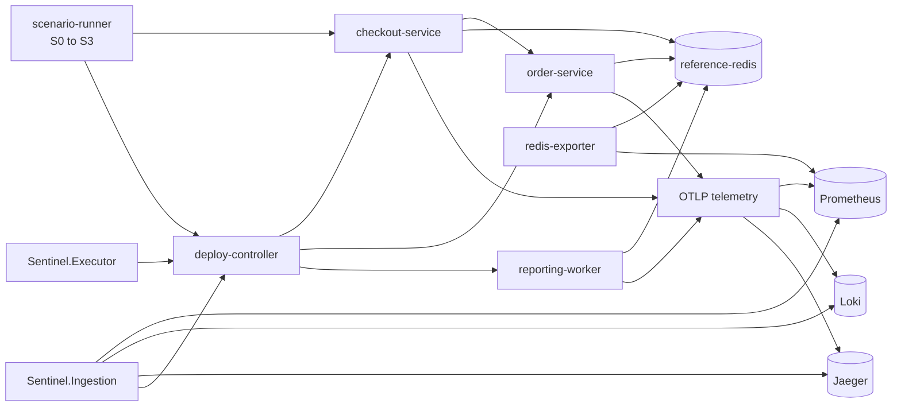
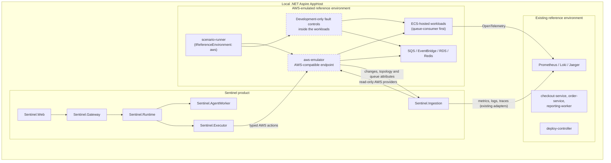

# AWS-emulated reference environment

- Status: Proposed
- Scope: Local and CI reference environment only
- Last reviewed: 2026-10-30, refined the same day after review (two tracks, hybrid telemetry, product-side work, identity mapping, widened spike), then aligned with the repository's naming conventions and linked to its delivery phase
- Delivery: [Phase E01 – AWS-emulated reference environment](../implementation/phase-e01-aws-emulated-reference-environment.md) carries the delivery stages below as an enhancement phase and the [phase status ledger](../implementation/phase-status.md#phase-e01--aws-emulated-reference-environment) records progress; this document stays the design source
- Related decisions: [ADR-010](../decisions/ADR-010-local-orchestration.md), [ADR-011](../decisions/ADR-011-reference-system-location.md), [ADR-014](../decisions/ADR-014-provider-abstraction.md), [ADR-020](../decisions/ADR-020-application-composition-and-cqrs.md)

## Purpose

Extend Sentinel's controlled reference system with an AWS-compatible environment that can produce richer, repeatable distributed-system incidents. The environment gives Sentinel realistic AWS API shapes, resource relationships, telemetry and remediation targets without making a cloud account or a particular emulator part of Sentinel's product architecture.

This document describes the existing reference system, the proposed addition, the scenarios it enables, its fidelity limits, the integration boundaries, the staged adoption plan and the evidence required before the proposal becomes an accepted architecture decision.

## Executive summary

Sentinel should continue to run under .NET Aspire. An AWS emulator should run **inside the reference-system boundary** as another observed environment. Sentinel must interact with it only through the same provider and remediation contracts it would use against AWS.

The first implementation should evaluate Floci because its advertised snapshot lifecycle, real ECS containers and broad AWS surface fit deterministic scenario execution. MiniStack remains a viable alternative and should be retained behind the same environment abstraction. Neither emulator should be used merely because it exposes more service names; the choice must be based on the small set of operations Sentinel's scenarios actually exercise.

The first vertical scenario should combine an SQS poison message, retries, an innocent ECS deployment and a DLQ. It tests causal reasoning, resistance to deployment bias, safe remediation and recovery verification in one path. Only after that path is reliable should the scenario catalogue expand.

Two goals meet in this proposal and are delivered on separate tracks. **Scenario diversity**, causes that are not deployments and remedies that are not rollbacks, needs only a queue and belongs in the existing reference system first, where it is cheap and strengthens the evaluation at once. **AWS realism**, AWS API shapes for adapter portability, IAM, EventBridge, account and region semantics, is what the emulator adds and what this document gates. The [scenario catalogue](#scenario-catalogue) marks which track each scenario belongs to.

Telemetry takes a hybrid path. AWS workloads keep emitting OpenTelemetry to the Prometheus, Loki and Jaeger the reference system already runs, so Sentinel's telemetry adapters and detection are unchanged; the emulator supplies changes, topology and remediation targets through ECS, SQS, IAM and EventBridge. Emulated CloudWatch is the weakest part of every AWS emulator and is adopted later, behind its own gate.

This proposal does **not** add a sixth Sentinel backend service, replace Aspire, redefine the production deployment target or claim that a local emulator exactly reproduces AWS failure behaviour.

## Current setup

The implemented reference system is a controlled .NET application under `reference-system/`. It is not part of the Sentinel product and neither side references the other's assemblies.



.NET Aspire currently starts:

- the five Sentinel services and `Sentinel.Web`;
- PostgreSQL, Redis Streams, Orleans infrastructure and Temporal;
- checkout, order and reporting workloads;
- the deploy controller and scenario runner;
- the reference system's separate Redis and a Redis client exporter;
- Prometheus, Loki and Jaeger;
- generated development-only control, deploy and read tokens.

The scenario runner resets the environment, warms it with seeded traffic, executes a versioned manifest and exposes progress through guarded HTTP endpoints and Aspire commands. `S0` to `S3` cover healthy noise, a Redis connection leak and two deployment-bias confounders. `S4` and `S5` are evaluation packages that perturb an existing scenario with a provider or remediation failure.

The names above are the Aspire resource names. In code, the workloads are the single projects `Reference.Checkout`, `Reference.Orders` and `Reference.ReportingWorker` under `reference-system/services/`, sharing `Reference.Common`; the deploy controller and the scenario runner are layered `Reference.DeployController.*` and `Reference.Scenarios.*` projects; manifests, packages and the baseline sit under `reference-system/scenarios/`; the observability configuration under `reference-system/deploy/`; and `deploy/local/Sentinel.AppHost/ReferenceSystemExtensions.cs` wires it all into Aspire ([ADR-011](../decisions/ADR-011-reference-system-location.md), [reference-system README](../../reference-system/README.md)). Failure controls are endpoints inside each workload behind the shared control-token guard in `Reference.Common`; there is no separate fault service.

The important existing invariants remain unchanged:

1. Sentinel never reads scenario ground truth.
2. Reference-system code never references a `Sentinel.*` package.
3. Sentinel reaches the fixture through telemetry, provider APIs and constrained remediation targets.
4. Failure controls are enabled only in explicit development or test environments.
5. Every scenario starts from a known state and defines discriminating evidence, permitted remediation, false remediation and recovery criteria.

## Why add an AWS-emulated environment

The current fixture proves Sentinel's reasoning loop, but its workload and deployment APIs are intentionally small. An AWS-compatible environment adds several kinds of evidence without requiring broad production access:

- **Recognizable infrastructure semantics.** Queues, DLQs, event routes, IAM policies, task revisions, regions and accounts are common operational concepts.
- **More ambiguous causal chains.** A visible deployment can coincide with a poison message, permission change or retry storm.
- **Provider realism.** Ingestion can exercise AWS SDK pagination, throttling, partial results, resource identifiers and CloudWatch query shapes.
- **Action realism.** Executor can operate through typed actions such as moving a message, restoring an event rule or reverting an ECS task definition.
- **Isolation testing.** Accounts and regions create natural tenant and environment boundaries.
- **Repeatable evaluation.** Snapshots or deterministic provisioning make larger scenarios reproducible.
- **Adapter portability.** The same Sentinel-owned interfaces can target an emulator locally and AWS in a later deployment without leaking AWS types downstream.

The value is not the number of emulated services. The value is a small set of causally rich scenarios whose ground truth, evidence and safe recovery can be verified.

### What the emulator does not add

Most of the causal variety Sentinel needs does not require AWS. A poison message, a retry storm, connection exhaustion, duplicate delivery and missing telemetry are properties of a queue, a pool or a provider, and the existing .NET reference system can host them with a plain queue in days rather than weeks. Those scenarios go into the existing environment first (the [scenario-diversity track](#scenario-catalogue)). The emulator earns its cost only where the AWS shape itself is the point: adapter portability against real SDK clients, IAM and EventBridge drift, account and region isolation, and a demonstration an AWS operator recognizes.

## Goals

- Run AWS-shaped workloads and infrastructure locally through Aspire.
- Preserve the existing five-service Sentinel topology.
- Exercise real AWS SDK clients against an endpoint override.
- Produce canonical observations through Ingestion's existing signal-specific interfaces, with AWS workloads emitting OpenTelemetry to the existing Prometheus, Loki and Jaeger until CloudWatch adapters pass their own gate.
- Detect each scenario through Runtime's detection-rule configuration, not new detection code.
- Execute only typed, policy-governed actions through Executor.
- Reset or restore every scenario deterministically.
- Support deterministic test-double investigations and separately recorded live-model evaluation.
- Keep emulator-specific behaviour inside the reference environment and infrastructure adapters.
- Record fidelity and known limitations per scenario.

## Non-goals

- Deploying Sentinel itself into the AWS emulator.
- Treating Aspire as a production deployment definition.
- Reproducing AWS availability-zone, control-plane or global-network behaviour exactly.
- Testing cloud billing, quota increases or production-scale throughput.
- Giving a model AWS credentials or allowing arbitrary AWS commands.
- Adding every emulator-supported service.
- Making Floci, MiniStack or AWS SDK types part of Sentinel contracts or domain models.
- Claiming production validation from an emulator-only result.

## Proposed topology



### Boundary rules

- Aspire owns process/container lifecycle and service wiring.
- The emulator is an external system from Sentinel's perspective.
- The reference-system scenario runner owns provisioning, reset, traffic and fault activation.
- Ingestion owns all read credentials and the AWS change, topology and queue-attribute adapters, and later any CloudWatch adapters.
- Executor owns all action credentials and AWS remediation adapters.
- Runtime, AgentWorker, Gateway and Web remain vendor-neutral.
- Fault controls stay inside the workloads behind the existing control-token guard, as in the current reference system; there is no separate fault-controller service.
- Scenario manifests and ground truth stay inaccessible to Sentinel processes.
- Emulator administration endpoints are never exposed as remediation tools.

## Proposed repository layout

The addition belongs under the existing reference-system boundary rather than under `services/` or `packages/`, and it follows the layout and names the reference system already uses: `Reference.<Name>` projects, hyphenated lower-case Aspire resource names, manifests and packages beside the existing ones, and [ADR-011's two composition levels](../decisions/ADR-011-reference-system-location.md#internal-composition-amendment-2026-10-29).

```text
reference-system/
├── deploy/
│   ├── loki/, prometheus/, redis-exporter/     existing
│   └── aws/                                    emulator configuration, pinned image digest, optional network controls
├── services/
│   ├── Reference.Checkout, Reference.Orders,
│   │   Reference.ReportingWorker, Reference.Common   existing workloads, file rules only
│   └── Reference.QueueConsumer/                the ECS-hosted consumer workload; same file rules, faults behind the control guard
├── scenarios/
│   ├── Reference.Scenarios.Domain/             existing
│   ├── Reference.Scenarios.Application/        existing; Abstractions/IReferenceEnvironment.cs, provisioning, reset and activation requests
│   ├── Reference.Scenarios.Infrastructure/     new; Environments/Local/ (today's behaviour) and Environments/Aws/ (the AWS SDK calls)
│   ├── Reference.Scenarios.Api/                existing host: controllers, DependencyContainer, Program.cs
│   ├── manifests/                              S0-healthy-noise.json ... and AWS-S0-healthy-aws-noise.json ... side by side
│   ├── packages/                               S0.json ... and AWS-S0.json ... evaluation packages, same schema
│   └── baseline/deploy-blame.md                extended with the queue scenarios' expected baseline outcomes
├── knowledge/                                  queue-consumer.md beside the existing runbooks
└── tests/Reference.Tests/                      existing; Environments/Aws/ conformance tests behind an emulator-required trait

deploy/local/Sentinel.AppHost/
├── ReferenceSystemExtensions.cs                existing
├── ReferenceSystemResources.cs                 existing
├── AwsReferenceEnvironmentExtensions.cs        AddAwsReferenceEnvironment(), resources prefixed aws-
└── AwsReferenceEnvironmentResources.cs         the record Sentinel's services are wired to, like ReferenceSystemResources
```

Conventions that follow from this:

- The scenario runner follows the composition guide in full, so provisioning, reset and activation are requests that go through the processor seam to handlers, and the environment implementations sit in a new `Reference.Scenarios.Infrastructure` project registered by its own dependency module. The runner has no Infrastructure project today; the AWS SDK is the first dependency that justifies one.
- The queue consumer is a workload like checkout, so it keeps the file and naming rules only: one type per file, a folder per concern, the injected fault in a clearly named file, a thin `Program.cs`, and no reference to the building blocks or to any `Sentinel.*` package.
- Manifests use the existing scenario contract and file naming (`<id>-<slug>.json`, the same keys as `S1-redis-connection-leak.json`) and add the environment, account and region they run in. Queue-track scenarios built in the existing environment take the next free `S` numbers; AWS-track scenarios keep the `AWS-S` prefix.
- Aspire resource names stay hyphenated and lower case (`aws-emulator`, `queue-consumer`), and generated tokens follow the `reference-*` parameter pattern.

This layout extends ADR-011 and is recorded in its amendment, together with the emulator decision in ADR-021, before implementation; it introduces neither a shared domain package nor a new Sentinel deployable.

## Environment abstraction

The scenario runner needs a small environment boundary. It should express lifecycle operations, not AWS APIs:

```csharp
public interface IReferenceEnvironment
{
    Task ProvisionAsync(CancellationToken cancellationToken);
    Task ResetAsync(CancellationToken cancellationToken);
    Task ActivateAsync(ScenarioStep step, CancellationToken cancellationToken);
    Task<EnvironmentState> InspectAsync(CancellationToken cancellationToken);
}
```

Guidelines:

- Keep the interface in `Reference.Scenarios.Application/Abstractions/`, with `EnvironmentState`, `ScenarioStep` and the typed errors each in their own file.
- Put AWS SDK calls in `Reference.Scenarios.Infrastructure/Environments/Aws/`, registered by that layer's dependency module and selected by configuration; the Api project stays composition, controllers and Aspire commands.
- Expose provisioning, reset and activation as requests through the processor seam, like the runner's existing run operations.
- Do not expose an emulator name in scenario manifests.
- Make reset idempotent.
- Return typed errors for unsupported operations, timeouts and partial resets.
- Record the emulator, image digest, scenario version and provisioning version with every run.
- Prefer the public AWS-compatible data/control APIs for provisioning and inspection.
- Use emulator-specific snapshot APIs only for lifecycle acceleration, never as Sentinel-facing capabilities.

## Sentinel provider additions

No new provider service is needed. AWS adapters belong in the existing owning services.

### Ingestion

Potential adapters in `Sentinel.Ingestion.Infrastructure/Providers/`, beside `DeployControllerProvider`, `PrometheusMetricsProvider`, `LokiLogsProvider`, `JaegerProvider`, `PrometheusAlertsProvider` and `RunbookDirectoryProvider`. Each implements the Application-layer interface for its signal (`IDeploymentProvider`, `ITopologyProvider`, `IMetricsProvider` and so on) and is named for its source, for example `EcsDeploymentProvider`, `AwsTopologyProvider` and `SqsQueueMetricsProvider`:

| Signal | AWS-compatible source | Canonical output | Stage |
| --- | --- | --- | --- |
| Deployments and changes | ECS task definitions and services, SQS queue attributes, IAM policy versions, EventBridge rules; Lambda versions later | deployment and change observations | 2 |
| Topology | ECS, SQS, EventBridge, RDS and ElastiCache metadata | services, dependencies and resources | 2 |
| Metrics | the existing Prometheus adapter over the workloads' OpenTelemetry, plus SQS queue attributes (depth, oldest-message age) polled as metric observations | metric observations with completeness and watermark | 2 |
| Logs and traces | the existing Loki and Jaeger adapters over the workloads' OpenTelemetry | redacted log and trace observations | unchanged |
| CloudWatch Metrics and Logs | CloudWatch Metrics, CloudWatch Logs Insights | metric and log observations | 3 or later, behind its own compatibility gate |
| Alerts | CloudWatch alarms and alarm history | alert observations | with CloudWatch |

Every adapter must pass the existing provider conformance expectations: deterministic identity, bounded time ranges, pagination, truncation, typed provider status, watermark behaviour, redaction and explicit partial failure. The stage column is the point: the first AWS scenario needs one change-and-topology adapter and queue attributes, not a CloudWatch family.

### Executor

Potential typed adapters in `Sentinel.Executor.Infrastructure/Remediation/`, beside `DeployControllerRollbackAdapter` and `ReportingBatchAdapter`. Each implements `IRemediationAdapter` for one action kind and is registered in `AdapterRegistration`, for example `SqsQuarantineAdapter`, `EcsTaskDefinitionRevertAdapter` and `EventBridgeRuleRestoreAdapter`:

- revert an ECS service to a known task definition;
- scale or restart an identified ECS workload within policy bounds;
- disable or restore a specific EventBridge rule/target;
- quarantine a specific SQS message through a scenario-owned control path;
- stop or resume a known consumer;
- restore a versioned IAM policy from an approved baseline;
- invoke a verified compensation action.

An action must still pass plan-time policy, approval when required, execution-time policy, operator controls, fencing and recovery verification. Executor must never expose a generic `aws` command, arbitrary SDK operation, shell or free-form resource ARN supplied by a model.

### Product-side work each scenario needs

No new service is needed, but every scenario with a new cause or remedy changes the product, and that cost belongs in the plan. Today Runtime's planner knows two plan templates (`rollback` and `pause-batch`), the action contract has two kinds, AgentWorker's tools cover metrics, logs, spans, dependencies, deployments and runbooks, and detection rules name a service and a metric. `AWS-S1` therefore needs:

| Where | Change |
| --- | --- |
| `Sentinel.Contracts` | A `QuarantineMessageAction` record derived from `RemediationAction` with the kind `quarantine-message`, beside `RollbackAction` (`rollback`) and `PauseBatchAction` (`pause-batch`), and the queue-related hypothesis keys. |
| `Sentinel.Executor` | `SqsQuarantineAdapter` implementing `Execute`, `Inspect`, `VerifyAction` and `Compensate`, registered in `AdapterRegistration`, and policy rules for the new action class. |
| `Sentinel.Runtime` | A `DetectionRuleOptions` entry for the consumer's error rate or the queue's oldest-message age, configured not coded; a plan template in `IncidentSteps` that proposes quarantine for a poison-message culprit; recovery criteria on queue age and error rate. |
| `Sentinel.AgentWorker` | A `QueueBacklogTool` beside `MetricRangeTool` and the other tools in `Application/Tools/`, over the observation query contract; prompt guidance for message-level causes; and the baseline's treatment of a non-deployment culprit. |
| `reference-system` | `Reference.QueueConsumer`, the queue and DLQ provisioning in the AWS environment implementation, the poison-message injection behind the control-token guard, and the manifest with discriminating signals. |

Each later scenario adds a row like this; a scenario that adds nothing to the product is a fixture test, not a Sentinel scenario.

### Identity mapping

An AWS account maps to a Sentinel tenant and a region to an environment. Every observation and action carries both, provider adapters set them from the resource's account and region, and the allow-list Executor checks before acting is keyed by them. `AWS-S8` and `AWS-S12` test this mapping; a scenario that cannot name its account and region is not admitted.

## First vertical scenario

### AWS-S1: poison message with an innocent deployment

```mermaid
sequenceDiagram
    participant Runner as scenario-runner
    participant Queue as SQS queue and DLQ
    participant Consumer as queue-consumer (ECS task)
    participant Emulator as Emulator control plane (ECS, SQS)
    participant Otel as Prometheus / Loki / Jaeger
    participant Ing as Sentinel.Ingestion
    participant Core as Sentinel.Runtime, AgentWorker, Gateway
    participant Ex as Sentinel.Executor

    Runner->>Queue: Publish one poison message
    Queue->>Consumer: Deliver message
    Consumer-->>Queue: Fail; visibility timeout expires
    Consumer->>Otel: Error and retry metrics, logs with the message fingerprint
    Runner->>Emulator: Release benign task revision
    Queue->>Consumer: Redeliver repeatedly
    Ing->>Otel: Metrics, logs and traces through the existing adapters
    Ing->>Emulator: Task revisions, topology, queue attributes (age, receive count)
    Ing-->>Core: Canonical observations
    Core->>Core: Compare poison-message and deployment hypotheses
    Core->>Ex: Approved typed quarantine action with attestation and fencing token
    Ex->>Queue: Quarantine the identified message
    Core->>Ing: Verify backlog, error rate and oldest-message age recover
```

Ground truth:

- The poison message is the cause.
- The deployment is benign and deliberately timed as a confounder.
- Rolling back ECS is a false remediation.
- Quarantining the identified message or stopping its retry loop is permitted.
- Recovery requires queue age, retry/error rate and consumer health to recover over a complete observation window.

Discriminating evidence:

- the first failure precedes the benign deployment;
- one message has a rising receive count while normal messages succeed;
- the same payload/error fingerprint appears across task revisions;
- unaffected messages and tasks continue processing;
- a rollback does not explain or remove the poison message.

This scenario is the first gate because it exercises provisioning, traffic, the existing telemetry path beside the first AWS change, topology and queue-attribute adapters, ECS and SQS topology, a confounding change, safe action and recovery without requiring a large service catalogue.

## Scenario catalogue

The catalogue below is a roadmap. Each scenario must be accepted independently after its emulator operations and fidelity are verified.

Each row names its track. **Queue** means the scenario needs only a queue and belongs in the existing reference system first; **AWS** means the AWS shape is the point and it waits for the emulator. A queue-track scenario may later get an AWS twin to prove adapter portability, but its reasoning value is captured without one.

| ID | Scenario | Injected cause and confounder | Expected outcome | Primary capabilities | Track |
| --- | --- | --- | --- | --- | --- |
| `AWS-S0` | Healthy AWS noise | Benign deployments and normal queue variation | No incident | false-positive control | AWS |
| `AWS-S1` | Poison message plus innocent deploy | One message retries; benign ECS revision follows | Quarantine/redrive the message; do not roll back | SQS, DLQ, ECS | Queue first, then AWS as the first emulator scenario |
| `AWS-S2` | Consumer regression | Faulty ECS task revision slows acknowledgements | Roll back the consumer revision | ECS, SQS, deployments | AWS |
| `AWS-S3` | Retry amplification | Downstream timeout triggers synchronized retries | Contain retries and address the downstream cause | queue, metrics | Queue |
| `AWS-S4` | IAM permission drift | Required action removed from a workload role | Restore approved policy version or escalate | IAM, STS, audit/change evidence | AWS |
| `AWS-S5` | Database connection exhaustion | Worker fan-out consumes RDS connections; benign API deploy follows | Stop fan-out or reduce it; do not blame API deploy | RDS, ECS | Queue-track analogue exists as `S2`; AWS twin optional |
| `AWS-S6` | Cache outage | Redis/ElastiCache process becomes unavailable | Use the approved cache recovery action and verify fallback | ElastiCache, workload telemetry | Queue (existing Redis) |
| `AWS-S7` | Event route drift | EventBridge rule target or filter changes | Restore the versioned route | EventBridge, SQS/Lambda, changes | AWS |
| `AWS-S8` | Wrong region or account | Workload configuration points to an isolated region/account | Correct configuration; do not create a duplicate resource | STS, regional resources, topology | AWS |
| `AWS-S9` | Partial ECS rollout | Only part of the task set runs a faulty revision | Identify revision-specific failures and roll back | ECS, load balancing, logs/traces | AWS |
| `AWS-S10` | Duplicate delivery | At-least-once delivery exposes non-idempotent processing | Contain duplicates and identify idempotency defect | queue, application evidence | Queue |
| `AWS-S11` | Missing telemetry | A provider is unavailable while metrics and changes remain | Diagnose cautiously or abstain; report incompleteness | provider failure handling | Queue (the existing `S4` perturbation already covers a provider failure) |
| `AWS-S12` | Cross-tenant collision test | Same resource names exist in two accounts | Keep observations, incidents and actions isolated | multi-account and tenant scoping | AWS |

Recommended order: the Queue rows `AWS-S1`, `AWS-S3` and `AWS-S10` in the existing reference system, then `AWS-S0` and `AWS-S1` on the emulator, then `AWS-S4`, `AWS-S7` and `AWS-S12`, which are the scenarios only AWS semantics can provide.

### Scenario admission rules

Do not add a scenario unless it has:

- a single named injected cause;
- at least one plausible competing hypothesis;
- discriminating signals available through supported APIs;
- explicit timing and bounded nondeterminism;
- a safe permitted remediation or a deliberate abstention outcome;
- named false remediations;
- measurable recovery criteria;
- an idempotent reset path;
- a fidelity statement identifying what is real, emulated and artificially injected;
- a resource budget and maximum duration;
- a deterministic baseline outcome.

## Fidelity model

An emulator supplies API compatibility and selected data-plane behaviour. The scenario runner and the workloads' development-only fault controls supply controlled failures. Neither should be mistaken for AWS production behaviour.

| Fidelity level | Meaning | Suitable claims |
| --- | --- | --- |
| Contract-real | Real AWS SDK, request signing, pagination and wire shape against an endpoint override | Adapter and contract compatibility |
| Data-plane-real | A real container/database/Redis process backs the emulated resource | Application and dependency behaviour within local limits |
| Emulator-modelled | The emulator stores state and returns AWS-shaped responses | Control-plane reasoning and resource relationships |
| Injected | The scenario controller, proxy or container runtime creates the failure | Sentinel's diagnosis and recovery logic under a declared fault |
| Unsupported | Behaviour cannot be represented credibly | No production claim; use a real cloud test later |

Examples that should not be claimed from local emulation alone:

- actual availability-zone or regional failure;
- AWS control-plane convergence and IAM propagation delays;
- production throttling and service quotas;
- managed RDS failover timing;
- cloud network jitter, packet loss or routing behaviour;
- AWS billing and cost allocation accuracy;
- hyperscale throughput or noisy-neighbour behaviour.

Latency, loss and partitions should be introduced with an explicit network-control component such as a proxy rather than attributed to the emulator. Every run report should identify that injection.

## Floci and MiniStack evaluation

The comparison records vendor claims as of 2026-10-30; the compatibility spike must verify the operations Sentinel uses.

| Criterion | Floci | MiniStack | Sentinel relevance |
| --- | --- | --- | --- |
| License and local use | Advertised MIT, no account/token | Advertised MIT, no account/token | reproducible local and CI use |
| AWS surface | Advertises 126 services | Advertises 60+ services | breadth is secondary to required operations |
| ECS | Advertises real Docker task execution | Advertises real Docker task execution | partial rollout and consumer scenarios |
| EKS | Advertises a real k3s node | Advertises EKS control-plane coverage | optional future scenario, not first scope |
| RDS/Redis | Advertises real PostgreSQL/MySQL and Redis | Advertises real PostgreSQL/MySQL and Redis | connection and dependency failures |
| State lifecycle | Persistence plus snapshot save/load | Reset endpoint and persistent state controls | deterministic scenario reset |
| Multi-account/region | Advertised service coverage; verify isolation | Explicit account and region isolation documentation | tenant and wrong-region scenarios |
| Documentation | Service catalogue and recipes | Per-operation coverage and known-limitations pages | spike must use documented operations only |

Primary sources:

- [Floci AWS emulator and service catalogue](https://floci.io/aws/)
- [MiniStack documentation](https://ministack.org/docs/)
- [MiniStack repository and internal test endpoints](https://github.com/ministackorg/ministack)

The capabilities above are the vendors' own claims and have not been verified here. LocalStack is the long-established AWS emulator with widely documented SQS, ECS and CloudWatch behaviour; the spike includes it as the known baseline so that the comparison is not between two unfamiliar products.

### Initial recommendation

Run the spike as a one-day time box whose only deliverable is a verified operation matrix: for each operation the first scenario needs, does the candidate implement it, at which fidelity level, and with which incompatibilities. Evaluate **Floci first**, then LocalStack Community as the baseline, and MiniStack only if both fall short; not all three in depth. Snapshot save/load, real ECS execution and its broader advertised service surface fit the scenario-runner lifecycle. This is a recommendation for a compatibility spike, not an accepted dependency.

Choose MiniStack instead if it demonstrates better behaviour, documentation or stability for the exact required operations. The architecture deliberately keeps that substitution local to Aspire and the reference environment.

### Compatibility gate

The candidate must pass all of these before an ADR accepts it:

1. Pin and start a container image through Aspire on the supported developer platforms.
2. Report readiness and shut down cleanly.
3. Provision SQS, a DLQ, ECS task and service metadata and the minimum IAM and STS resources; CloudWatch Logs and Metrics are tested too, but their result gates only the Stage 3 adapters.
4. Run a real containerized consumer or an equivalent real workload path.
5. Exercise the same AWS SDK clients intended for Sentinel adapters.
6. Reset or restore the environment repeatedly without stale resources.
7. Demonstrate account and region isolation for the operations used.
8. Complete the first scenario within the agreed local resource and time budget.
9. Run without external credentials, telemetry upload or paid services.
10. Publish known incompatibilities and the exact tested image digest.

Failure of the gate should not block Sentinel. The existing reference system remains authoritative and the spike can try MiniStack or stop.

## Aspire integration

Add the candidate as a pinned container resource named `aws-emulator` in `AwsReferenceEnvironmentExtensions.cs`, whose `AddAwsReferenceEnvironment()` returns an `AwsReferenceEnvironmentResources` record the way `AddReferenceSystem()` returns `ReferenceSystemResources`, and enable it only through explicit configuration, `Sentinel:ReferenceEnvironment=aws`, beside the existing `Sentinel:ReferenceOnly` and `Sentinel:EphemeralStorage` switches in `AppHost.cs`. The existing environment remains the default until the new path is stable.

The AppHost should:

- expose one internal AWS endpoint to provisioner, workloads and Sentinel adapters;
- generate synthetic access-key material and a fixed development region;
- add readiness checks before provisioning or scenario execution;
- mount persistent/snapshot storage only when requested;
- mount the Docker socket only if real ECS execution requires it;
- place the emulator and its workloads on an isolated local network;
- cap CPU, memory, queue depth, traffic and scenario duration;
- pass endpoint overrides explicitly rather than changing machine-wide AWS configuration;
- never read a developer's default AWS credential chain;
- label the emulator, image digest and enabled fidelity mode in run metadata.

### Docker-socket risk

An emulator that launches real containers may require access to the Docker socket. That is effectively host-level container control. The mount must be limited to the local/CI fixture, documented visibly, disabled when unnecessary and never included in a production definition. CI must use an isolated runner rather than a shared privileged host.

## Security and trust boundaries

- Use synthetic credentials and data only.
- Use explicit endpoint overrides and prevent fallback to real AWS endpoints.
- Deny outbound network access where practical after images are available.
- Keep scenario-control and emulator-administration credentials separate from Sentinel read/action credentials.
- Give Ingestion read-only permissions for the resources it observes.
- Give Executor only the typed action permissions required by the active scenarios.
- Do not expose snapshot, reset, fault injection or provisioning APIs to AgentWorker.
- Redact logs before canonical observations are stored or sent to a model.
- Preserve account, region, tenant and environment identity on every observation and action.
- Audit every provisioning, injection, remediation and reset operation.
- Validate resource identifiers against the scenario-owned allow-list before action execution.

## Reliability and reset semantics

A scenario is useful only when repeated runs are independent.

Reset order:

1. Stop traffic and scenario timers.
2. Cancel or fence active remediation.
3. Stop scenario workloads.
4. Restore a verified snapshot or delete/re-provision owned resources.
5. Restore baseline policies, routes, revisions and queue state.
6. Start workloads and traffic at the healthy baseline.
7. Wait for health and telemetry readiness.
8. Verify that no previous scenario identifiers or messages remain.

Snapshot restoration is an optimization, not the definition of correctness. A conformance test must prove that restore and clean provisioning produce equivalent observable baseline state.

## Observability

The environment itself needs observability distinct from the incidents it generates:

- emulator readiness, operation latency and error counts;
- provisioning/reset duration and failures;
- workload/task state;
- queue depth, oldest-message age, receive count and DLQ movement;
- telemetry export lag and completeness;
- fault activation/deactivation timestamps;
- resource consumption by emulator and workloads;
- scenario and provisioning version labels.

Control-plane logs used to operate the fixture must not be handed to investigators as causal evidence unless the scenario contract explicitly declares them observable production evidence.

## Testing strategy

### Unit and contract tests

- Manifest validation and scenario ground truth.
- AWS response translation into canonical observations.
- Pagination, throttling, truncation and partial failure mapping.
- Typed remediation validation and resource allow-listing.
- Environment lifecycle state machine and idempotency.

### Environment conformance tests

Run against the pinned emulator image:

- provisioning from empty state;
- repeated reset/restore;
- account and region isolation;
- required AWS operations and response fields;
- readiness and failure reporting;
- absence of fallback calls to real AWS endpoints.

### Scenario tests

- The healthy control never crosses incident thresholds.
- The injected symptom and every discriminating signal appear in bounded time.
- False remediations do not satisfy the recovery criteria.
- The permitted remediation restores all required signals.
- Reset returns the system to the same observable baseline.

### Sentinel end-to-end tests

- Ingestion produces canonical, tenant-scoped observations with completeness metadata.
- Runtime opens and correlates the expected incident.
- Deterministic investigators identify or safely abstain according to ground truth.
- Executor accepts only the permitted typed action.
- Recovery verification uses telemetry rather than the action response.
- Replay reproduces the decision from captured inputs.

Live-model evaluation remains separate from deterministic CI so tests stay reproducible and do not consume provider credits.

## Evaluation outputs

Every recorded run should include:

- environment and emulator identity, version and image digest;
- scenario and provisioning versions;
- seed, timeline and actual activation timestamps;
- fidelity classification for each important signal and failure;
- Sentinel and baseline diagnoses;
- leading, rejected and dissenting hypotheses;
- evidence precision and missing-data declarations;
- action, policy trace, approval and execution outcome;
- time to detect, diagnose, decide, execute and verify;
- false-remediation and abstention outcome;
- model, token, latency and estimated-cost data when a live model is used;
- reset result and leaked-resource check.

## Delivery stages

[Phase E01](../implementation/phase-e01-aws-emulated-reference-environment.md) carries these stages as its workstreams, with the entry evidence, test plan and exit criteria of an implementation phase; the [phase status ledger](../implementation/phase-status.md#phase-e01--aws-emulated-reference-environment) records how far they have got.

### Stage 0: decision evidence

- Amend ADR-011 with the layout and composition rules above.
- Add ADR-021 selecting the first emulator only after the compatibility gate.
- Define resource limits and CI privilege constraints.

### Stage 0b: scenario diversity without the emulator

- Add a plain queue to the existing reference system and the Queue-track scenarios `AWS-S1`, `AWS-S3` and `AWS-S10` as `S6` onward, with their manifests, baseline outcomes and evaluation packages.
- Add the product-side work the poison-message scenario needs: the action kind, the Executor adapter, the Runtime detection rule, plan template and recovery criteria, and the AgentWorker queue tool.
- This stage has no emulator dependency and raises the evaluation's scenario count and variety immediately; it is the fastest route to evidence.

### Stage 1: healthy AWS environment

- Start the pinned emulator through Aspire.
- Provision an SQS queue and DLQ and the ECS-hosted `queue-consumer`, which exports OpenTelemetry to the existing Prometheus, Loki and Jaeger.
- Add `AWS-S0` and prove deterministic reset.
- Do not add Sentinel AWS adapters yet; validate the fixture independently.
- Keep Lambda out of Stages 1 and 2; ECS and SQS carry the first scenarios.
- Fix the default developer profile budget before Stage 1 ends: the CPU, memory and wall-clock the emulator plus workloads may take on a Windows Docker Desktop machine, and the sequential-only rule for heavyweight scenarios.

### Stage 2: one vertical scenario

- Implement `AWS-S1` end to end.
- Add only the Ingestion and Executor operations it requires: the change-and-topology adapter, queue attributes as metrics, and the SQS quarantine adapter. The workloads' metrics, logs and traces keep flowing through the existing OpenTelemetry path.
- Reuse the Runtime and AgentWorker work from Stage 0b; the AWS twin changes adapters, not reasoning.
- Add the deterministic baseline and scenario evaluation package.
- Make the full run repeatable before expanding service coverage.

### Stage 3: product integration quality

- Gate and add the CloudWatch Metrics and Logs adapters, if the operation matrix shows the emulator implements the queries the adapters need; otherwise keep the hybrid telemetry path and say so in the fidelity statement.
- Add provider conformance suites.
- Add real-system web journey coverage for the incident.
- Surface environment/fidelity labels and comparison results.
- Add replay and captured-run support.

### Stage 4: scenario expansion

- Add scenarios in descending evidence value, not by emulator service count.
- Prefer IAM drift, RDS exhaustion, EventBridge drift and tenant isolation before optional Kubernetes breadth.
- Admit each scenario only when its fidelity and reset tests pass.

### Stage 5: real-cloud validation

- Run a deliberately small subset against an isolated AWS test account when production claims require it.
- Compare emulator and AWS behaviour and record divergences.
- Keep destructive actions constrained to scenario-owned resources.

## Risks and mitigations

| Risk | Consequence | Mitigation |
| --- | --- | --- |
| Emulator implements only a shallow stub | Scenario passes without meaningful data-plane behaviour | verify each required operation and classify fidelity |
| Broad service catalogue drives scope | Time is spent provisioning instead of improving Sentinel | one vertical scenario first; scenario admission rules |
| Emulator-specific APIs leak into Sentinel | Local fixture becomes product coupling | isolate lifecycle APIs in reference-system infrastructure |
| Docker socket grants excessive privilege | Local or CI host compromise | isolated runner, explicit opt-in, no production mount |
| Tests accidentally contact AWS | Cost, data exposure or destructive action | explicit endpoint override, synthetic keys and outbound controls |
| Reset leaves state behind | Nondeterministic diagnosis and false evidence | reset conformance, leaked-resource check and versioned snapshots |
| Emulated timing differs from AWS | Incorrect production confidence | fidelity labels and later real-cloud comparison |
| Developer machine is exhausted | Unreliable local runs | resource caps, minimal services and sequential heavyweight scenarios |
| Provider adapter grows around emulator quirks | Poor AWS portability | test canonical behaviour and document compatibility exceptions |
| Scenario ground truth leaks to Sentinel | Invalid evaluation | process and credential separation; no shared assemblies or files |
| Queue-track scenarios are built on the emulator anyway | Weeks of provisioning before the first new reasoning scenario exists | the track column and Stage 0b; a scenario needing only a queue is built in the existing reference system first |
| Emulated CloudWatch queries diverge from AWS | Adapters tuned to the emulator fail against AWS | hybrid telemetry path first; CloudWatch adapters gated and compared against a real account in Stage 5 |
| Continuous integration does not exist yet | Conformance and reset tests run only on developer machines | the Phase 00 CI pipeline is a prerequisite for Stage 1's isolated-runner requirement and is tracked in the phase ledger |

## Decision record required before implementation

This document is a maintained proposal, not an accepted platform choice. Before implementation becomes part of the supported local topology, create ADR-021 that records:

- the selected emulator and pinned version/digest;
- the verified operation matrix;
- why the alternative was rejected;
- Docker-socket and CI security implications;
- reset strategy and local resource budget;
- directory amendment to ADR-011;
- ownership of AWS provider and remediation adapters;
- replacement and exit criteria.

## Success criteria

The addition is successful when:

1. The Queue-track scenarios run in the existing reference system and appear in the evaluation report with their baseline comparison before the emulator is adopted.
2. Aspire starts either the existing environment or the AWS environment with one explicit configuration choice.
3. `AWS-S0` and `AWS-S1` run repeatedly from clean state within bounded time and resources.
4. Sentinel diagnoses the poison-message scenario from canonical evidence and rejects the innocent deployment hypothesis.
5. The deploy-blame baseline chooses the wrong action, creating a measurable comparison.
6. Only an approved typed remediation can affect scenario resources.
7. Telemetry proves recovery and reset proves no state leaked into the next run.
8. The result records its fidelity and does not overclaim AWS equivalence.
9. Replacing Floci with MiniStack would require reference-infrastructure changes, not changes to Runtime, AgentWorker, Gateway, Web or canonical contracts.

## Open questions

- Does the selected emulator implement the exact CloudWatch Logs and Metrics queries the Stage 3 adapters would need?
- Can ECS workload execution, task revisions and logs be made deterministic on Windows Docker Desktop and CI?
- Does snapshot restoration preserve all required data-plane state, or should scenarios always re-provision queues and messages?
- Which network-control mechanism best fits Aspire without adding unnecessary privilege?
- Should the first remediation quarantine a message through a scenario-owned typed endpoint or through a verified AWS-compatible redrive operation?
- What CPU, memory and maximum run time are acceptable for the default developer profile?
- Which small subset must eventually run in a real AWS test account before an adapter is described as production-compatible?
- Which queue should the existing reference system use for the Queue-track scenarios: its own Redis Streams, which the workloads already reach, or a small broker that behaves more like SQS (visibility timeout, receive count, dead-letter redrive)?
- Should the account-to-tenant and region-to-environment mapping be fixed, or configurable per deployment with the mapping recorded in run metadata?

