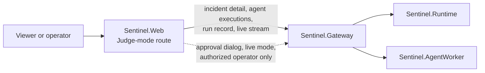

# Judge mode

- Status: Proposed, 2026-10-31; revised the same day to a first slice built on records Sentinel already serves
- Delivery: [Phase E04 – Judge mode](../implementation/phase-e04-judge-mode.md); the [phase status ledger](../implementation/phase-status.md#phase-e04--judge-mode) records progress
- Related: [Demonstration depth](demonstration-depth.md) (Phase E03), [frontend design system](frontend-design-system.md), [ADR-001](../decisions/ADR-001-production-first-service-topology.md), [ADR-006](../decisions/ADR-006-remediation-control-path.md), [ADR-019](../decisions/ADR-019-incident-memory-replay-and-retention.md)

## Purpose

Sentinel already records what it needs to prove an incident: the signals that opened it, every specialist's tool calls and findings, the competing hypotheses, the challenges that eliminated the easy answer, the versioned decision, the policy trace, the signed approval, the typed action, the recovery measurements and the baseline that ran in its shadow. Today a reader assembles that proof from the incident page, the postmortem, the agent executions and the run record.

Judge mode is one guided view that walks a single incident from context to proven recovery, one question per stage, with every claim opening its source. It is a presentation of existing records, not a second implementation of Sentinel: it chooses no diagnosis, advances no incident, approves nothing, runs nothing and never manufactures an outcome. The name is the view's, not a runtime mode's.

It serves three needs: an evaluator understands what Sentinel did and why in a few minutes; an operator hands an incident over with its reasoning and safety controls intact; a customer inspects a recorded proof without being given control of the observed environment.

## The five questions

Every stage exists to answer one of these, and the view succeeds only when every answer is derived from a recorded source that can be opened:

1. What failed, and what was the operational consequence?
2. What evidence did Sentinel gather, and which tempting explanation did it reject?
3. How did the models contribute beyond a text completion?
4. Which policy and human controls governed the proposed action?
5. Did the action merely execute, or did independent telemetry prove recovery?

## What already exists

The first slice adds no contract, no projection and no storage. Every stage reads a field the Gateway already serves to the incident page.

| Stage | Question | Source today |
| --- | --- | --- |
| Context | What is at risk? | `IncidentDetail.Summary`, `AffectedServices`, the SLO in `LinkedSignals` |
| Detection | What opened the incident? | `TriggerObservationIds`, `LinkedSignals`, `Changes`, the first `Timeline` entries |
| Investigation | What did each specialist examine? | `Investigations`, and `GET /incidents/{id}/agent-executions` for tools, citations, model, prompt version, latency, tokens and cost |
| Hypothesis | What explanations competed? | `Hypotheses`, `Evidence` with direction and strength |
| Challenge | What easy answer failed scrutiny? | `Challenges`: falsifier, verdict, decisive evidence |
| Decision | Why act or abstain? | `Decisions`, the current `Decision`: cause, confidence, dissent, unknowns, algorithm version, input hash |
| Counterfactual | What would deploy-blame have done? | The baseline's own execution in `agent-executions`; the run record's outcome comparison |
| Governance | Who or what allowed the plan? | `Plan`: policy evaluation and rule trace, plan hash, approval, approver, status |
| Action | What changed in the environment? | `Execution`: typed action, start confirmation, target verification, outcome |
| Recovery | Did the system improve? | `Recovery` measurements and verdict, `RemediesTried`, `Cycle` for a follow-up cycle |
| Manipulation | Was Sentinel told what to conclude? | `SuspectedInjections` and the timeline entry that says they were ignored |

A captured run is the run record the Gateway already exports (`GET /incidents/{id}/run-record`), the same document the end-to-end suite writes under `artifacts/reports/`. A stored incident is served live from the same endpoints. Nothing new has to be persisted for the first slice.

## Principles

- **One system, two presentations.** The incident workspace and Judge mode read the same Gateway contracts. Judge mode may select, order and summarize, but it owns no fact and computes no verdict.
- **Truth before theatre.** Every headline claim carries a source link. Recorded facts are distinguished from the view's deterministic summaries. Motion marks a recorded transition and never implies one that did not happen.
- **Honest modes.** A persistent truth bar shows `Live` (following an incident now) or `Captured` (an immutable run record). Captured playback at accelerated speed keeps the original timestamps visible and is never labelled live.
- **Failure is a valid ending.** Abstention, policy denial, a rejected approval, a failed action, a provider outage and inconclusive recovery each end the story with what stopped, why, and what a responder does next. The view never advances past an unmet condition.
- **Progressive disclosure.** The first layer is the operational story; the second is the evidence, challenges, model executions, policy traces and measurements; the full workspace is one click away with the current item selected.

## Modes

| Mode | Source | Mutability |
| --- | --- | --- |
| `Live` | An active or completed incident, through the existing incident queries and the Gateway's server-sent event stream | Read-only view; an operator with approval permission uses the normal approval dialog, which calls the normal Gateway command |
| `Captured` | A run record, from the Gateway for a stored incident or from a bundled file for an offline demonstration | Read-only |

Recorded-versus-replayed comparison is deferred (see below); the domain replay endpoint exists and the comparison can be added as a stage when a decision calls for it.

## Guided narrative

The narrative is derived from the incident's records, not from a stored slide sequence. A stage appears only when its source exists, and its status is one of `active`, `complete`, `failed` or `inconclusive`, taken from the records it reads. Because a stage appears only with its source, none is ever pending. The stage rail allows direct navigation once a stage exists. In `Live` mode it follows the newest stage until the viewer inspects an earlier one.

Deterministic, versioned templates turn typed facts into each stage's one-paragraph summary, so playback is reproducible and needs no model call. A model-drafted explanation is deferred (see below).

## Model contribution

For every specialist and the verifier, the Investigation stage shows the configured profile and model, the role and prompt version, the typed tools requested and the observation identifiers they returned, the validated findings with their citations and unknowns, validation and retry outcomes, latency, tokens and estimated cost, and how consensus and the verifier used or rejected the contribution. This is what demonstrates the models' part in a bounded system: they choose evidence queries and produce typed, attributable findings, while Sentinel validates, challenges and keeps policy and execution outside the model boundary. Hidden reasoning is never shown; a provider failure is shown as such.

All of it is in the agent-executions query today and partly rendered by the design system's agent-activity pattern.

## Information architecture

A route in `Sentinel.Web`, reached from an incident page and from a list of captured runs, built from the governed design system ([ADR-002](../decisions/ADR-002-frontend-design-system.md)) and the primitives Phase E02 added. Five regions:

1. **Truth bar**: mode, environment, incident or capture identity, source freshness, provider state.
2. **Stage rail**: the derived stages and their status.
3. **Proof canvas**: the current stage's summary and its comparison, for example Sentinel's verdict beside the baseline's.
4. **Evidence drawer**: the stage's source records with provenance, each linking into the workspace.
5. **Outcome strip**: incident state, action state, recovery verdict, next human step.

The causal graph remains the documented visualization exception. Colour is never the only carrier of meaning, every control is keyboard operable, playback honours reduced motion, and the layout is verified at desktop and the 768 px tablet width.

## Architecture

- `Sentinel.Web` owns the route, stage derivation, playback and disclosure. Stage derivation is a pure function of the records it reads and is unit-tested as such.
- `Sentinel.Gateway` is unchanged: the existing authorized, tenant-scoped queries and the existing approval command.
- No service, contract, projection, storage or deployable is added. If a later slice needs the server to build or store a proof, that work gets its own decision record and stays in the owning service or the Gateway's read model ([ADR-001](../decisions/ADR-001-production-first-service-topology.md)).

## Security

- The same identity, tenant and environment scope as the incident workspace; a viewer sees what the workspace would show them and nothing more.
- Captured mode is read-only. Live mode exposes no control the workspace does not: approval, rejection and revocation use the existing dialogs and commands with their plan hash, recent-authentication and attestation checks. There is no presenter role and no Judge-mode authorization path.
- Evidence reaches the view already redacted. Logs, runbooks, model output and run-record metadata are untrusted data and are rendered as text.
- The browser receives no provider, telemetry or action credential.

## Failure behaviour

| Failure | Behaviour |
| --- | --- |
| Live stream disconnects | Freeze at the last event, mark stale, reconnect with backoff, resume without duplicating stages |
| A model call failed or abstained | Show that specialist's state as recorded; the other stages stand |
| Agent-execution detail unavailable | Mark the detail unavailable; never infer it from the diagnosis |
| Approval expires or is revoked | Governance and Action stages follow the authoritative event |
| Action fails | The Action stage ends failed and shows the escalation or compensation state |
| Recovery inconclusive | Show coverage and the missing signals; never treat the adapter's success as recovery |
| Run record unreadable or from an unknown schema version | Refuse guided playback and show the record's versions |

## Deferred, with the decision each needs

| Capability | Why not in the first slice | Decision needed first |
| --- | --- | --- |
| Proof manifest with canonical hashing and signing | Adds a persisted format and a key decision; the run record already carries versions and identifiers | Canonicalization, key ownership and verification record |
| Export with redaction, retention and purge | A disclosure policy question, not a presentation one | Disclosure and retention policy for exported records |
| Recorded-versus-replayed comparison stage | The replay endpoint exists; the comparison UI is a stage of its own once a user asks for it | None; schedule when wanted |
| Model-drafted explanation | Deterministic summaries cover the demonstration; a drafted layer needs grounding and labelling rules | Grounding, labelling and caching rules |
| Public or expiring share links | Changes the trust model of incident identifiers | Approver identity ([ADR-023](../decisions/ADR-023-approver-identity.md)) and a sharing decision |
| Feature flag, staged rollout, dashboards, runbook | General-availability concerns that arrive with the deployment definition (Phase 09) | The deployment definition |

## Success criteria

1. A captured `S9` run plays from context to verified recovery with the observed environment, the scenario runner and every model offline, and every material claim opens its source.
2. The same view follows a live incident and advances only from recorded events, including the abstention, denial, failure and inconclusive endings.
3. `S10` shows the first remedy, the unrecovered verdict, the follow-up cycle, the second approval and the final recovery without hiding the correction.
4. `Live` and `Captured` are distinguishable at all times; accelerated playback keeps original timestamps.
5. Captured mode cannot mutate anything, and live mode exposes only the workspace's own controls under their existing checks.
6. The route passes the desktop and tablet journeys, the accessibility and screenshot checks and the long-incident bounds the incident page already meets.

## Open questions

- Is "Judge mode" the product name, or an internal one for a view that customers would call an incident proof or review view?

Answered by slice 1:

- Captured runs load from stored incidents, through the run record the Gateway exports. The web app bundles run records only as its test fixtures; a bundled demonstration set would need the disclosure decision export needs.
- The Investigation stage summarizes Phase E03's live investigation panel: it reads the same per-role progress and adds each execution's model, prompt version, tool calls and tokens, and the escalation's query when there is one.
