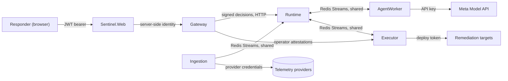

# Threat model

Sentinel watches production telemetry, reasons about it with language models and can roll back production services. This document records what an attacker or a fault could do at each trust boundary, what the implementation does about it today, with links to the code, and what remains open. It is a Phase 09 deliverable ([production hardening](../implementation/phase-09-production-hardening.md)) and is reviewed whenever a boundary changes.

- Last reviewed: 2026-10-29, against the code at that date, after the implementation review of the same day ([findings](#review-findings-of-2026-10-29)).
- Scope: the five services, the web app, the messaging Redis, PostgreSQL, Temporal, the model API and the remediation targets. The reference system is a test fixture and out of scope, except where its controls are reachable.

## Assets

| Asset | Why it matters | Owner |
| --- | --- | --- |
| The privileged action path | A forged or replayed approval could roll back a healthy production service. | Executor, with Runtime and the Gateway |
| Privileged credentials | The deploy controller's token can change what production runs. | Executor only ([ADR-006](../decisions/ADR-006-remediation-control-path.md)) |
| Provider and model credentials | Telemetry access and paid model credit. | Ingestion for telemetry, AgentWorker for models ([ADR-007](../decisions/ADR-007-cross-service-code-and-provider-access.md)) |
| Incident truth | The event stream decides what Sentinel believes and does. | Runtime ([ADR-004](../decisions/ADR-004-runtime-state-ownership.md)) |
| Tenant data | Telemetry, incidents and memory are confidential per tenant. | Every service |
| Approval signing keys | Whoever holds them can approve any plan. | The Gateway |

## Trust boundaries and data flows

| Boundary | Crossing | Authentication today |
| --- | --- | --- |
| Responder to Gateway | HTTPS from the web app | JWT bearer with responder, approver and operator roles; a development identity exists only in Development ([IdentityExtensions](../../services/Sentinel.Gateway/src/Sentinel.Gateway.Api/Identity/IdentityExtensions.cs)) |
| Gateway to Runtime and Executor | Decisions and control-plane changes | Each decision and operator action is an ES256 attestation the receiver verifies ([ADR-006 amendment](../decisions/ADR-006-remediation-control-path.md)) |
| Service to service, other calls | Internal HTTP and Redis Streams | None. The services trust the network ([F-007](#review-findings-of-2026-10-29)). |
| AgentWorker to the model API | HTTPS | API key from secret configuration |
| Ingestion to telemetry providers | HTTPS | Provider credentials from secret configuration |
| Executor to remediation targets | HTTPS | The deploy controller's token, held only by Executor |

## Threats and mitigations

### The privileged action path

| Threat | Mitigation | Evidence |
| --- | --- | --- |
| A forged approval executes a plan | Executor verifies the Gateway's ES256 attestation against published keys, audience `sentinel-executor`, scope `execute-plan`, expiry, and the incident, plan version and content hash it binds. | [AttestationVerifier](../../services/Sentinel.Executor/src/Sentinel.Executor.Application/Services/AttestationVerifier.cs), [AttestationTests](../../services/Sentinel.Executor/tests/Sentinel.Executor.Tests/AttestationTests.cs) |
| A forged decision on the shared bus approves, rejects or revokes | Runtime verifies every approver decision the same way before recording it, and drops one that fails. | [DecisionVerifier](../../services/Sentinel.Runtime/src/Sentinel.Runtime.Application/Services/DecisionVerifier.cs), [DecisionVerifierTests](../../services/Sentinel.Runtime/tests/Sentinel.Runtime.Tests/DecisionVerifierTests.cs) |
| An approval is replayed | An attestation is consumed on first use. | [ExecutionTests](../../services/Sentinel.Executor/tests/Sentinel.Executor.Tests/ExecutionTests.cs) |
| A plan changes after approval | The approval binds the plan's content hash; a new plan version clears the approval, and its execution cannot be requested or started. | [RemediationLifecycleTests](../../services/Sentinel.Runtime/tests/Sentinel.Runtime.Tests/RemediationLifecycleTests.cs) |
| A revocation is reported but the action proceeds | Revocation is a request Runtime answers; the Gateway records it only when Runtime accepted, and Runtime refuses once execution started. | [RecordRevocationCommandHandler](../../services/Sentinel.Runtime/src/Sentinel.Runtime.Application/BusinessTasks/Commands/Remediation/RecordRevocationCommandHandler.cs), [RuntimeFlowTests](../../services/Sentinel.Runtime/tests/Sentinel.Runtime.Tests/RuntimeFlowTests.cs) |
| A retired or compromised signing key keeps working | Verifiers re-read the published key set every five minutes, honour each key's validity window, and trust no key once the set has been unreadable for an hour. Every replaced key, including one a Gateway restart left behind, leaves the set once its attestations expire, and a suspected compromise is answered by a restart with Executor stopped. | [ApiApprovalKeys](../../services/Sentinel.Executor/src/Sentinel.Executor.Infrastructure/Clients/ApiApprovalKeys.cs), [ApiApprovalKeysTests](../../services/Sentinel.Executor/tests/Sentinel.Executor.Tests/ApiApprovalKeysTests.cs), [LocalApprovalSignerTests](../../services/Sentinel.Gateway/tests/Sentinel.Gateway.Tests/LocalApprovalSignerTests.cs), [signing key rotation](../runbooks/signing-key-rotation.md) |
| A duplicate or stale command repeats an action | Idempotency keys bound only after authentication, fencing tokens, and start confirmation by Runtime immediately before any side effect. | [ExecutionTests](../../services/Sentinel.Executor/tests/Sentinel.Executor.Tests/ExecutionTests.cs) |
| An unauthenticated operator changes policy or engages controls | Executor requires a single-use operator attestation and records the actor from its claims, with every control change audited in the same transaction. | [OperatorAttestationFilter](../../services/Sentinel.Executor/src/Sentinel.Executor.Api/Filters/OperatorAttestationFilter.cs), [PostgresControlStoreTests](../../services/Sentinel.Executor/tests/Sentinel.Executor.Tests/PostgresControlStoreTests.cs) |
| An agent runs a privileged action | Agents have no action tools; findings that propose actions are refused, and actions go through policy, approval and capabilities. | [FindingsValidatorTests](../../services/Sentinel.AgentWorker/tests/Sentinel.AgentWorker.Tests/FindingsValidatorTests.cs), [PolicyEngine](../../services/Sentinel.Executor/src/Sentinel.Executor.Domain/Policy/PolicyEngine.cs) |

### Untrusted content and the models

| Threat | Mitigation | Evidence |
| --- | --- | --- |
| Instructions planted in logs or runbooks steer an investigation | Telemetry and documents reach the model only as tool results in the data channel, never as instructions; findings must cite observations a tool returned; runbook passages cannot be cited. | [InvestigatorPrompt](../../services/Sentinel.AgentWorker/src/Sentinel.AgentWorker.Application/Investigations/InvestigatorPrompt.cs), [planted runbook fixture](../../reference-system/knowledge/reporting-worker.md), [runbook and log injection tests](../../services/Sentinel.AgentWorker/tests/Sentinel.AgentWorker.Tests/SpecialistTests.cs) |
| A model fabricates evidence | Every cited observation must have been returned by a tool in that execution; the evaluation harness also scores hallucinated evidence. | [FindingsValidator](../../services/Sentinel.AgentWorker/src/Sentinel.AgentWorker.Application/Investigations/FindingsValidator.cs), [scoring.py](../../scripts/evaluation/sentinel_eval/scoring.py) |
| Incident data trains a third-party model | Profiles use Meta's standard mode, whose content is not used for training; Contributor-mode models are not routed by default. | [ADR-015 revisit](../decisions/ADR-015-model-abstraction.md) |
| Runaway model spend | Per-call cost estimates, total, daily and per-model caps; at a cap the investigation abstains. | [ModelSpendGuard](../../services/Sentinel.AgentWorker/src/Sentinel.AgentWorker.Application/Investigations/ModelSpendGuard.cs) |
| An operator-supplied artifact, a frame or a document carries a planted instruction or a false claim | Artifacts are evidence candidates: redacted before storage, scanned for planted instructions, and a claim becomes evidence only when Ingestion corroborates it; frames are measured by deterministic rules. | [ADR-024](../decisions/ADR-024-model-roles.md) (Proposed); [Phase E06](../implementation/phase-e06-incident-artifacts.md), [Phase E07](../implementation/phase-e07-visual-synthetic-monitor.md) |
| A generated image misrepresents an incident | No generated imagery appears in an incident record, a postmortem or a communication derived from one; charts, timelines and topology are rendered deterministically from records. | [ADR-024](../decisions/ADR-024-model-roles.md) (Proposed); [EvidenceGraph](../../apps/Sentinel.Web/src/design-system/patterns/evidence-graph.tsx) |
| A spoken, written or pictured instruction approves an action | No model approves, rejects or revokes a plan or issues a capability; approvals exist only as signed Gateway attestations on a plan hash. | [ADR-006](../decisions/ADR-006-remediation-control-path.md), [ADR-024](../decisions/ADR-024-model-roles.md) |

### Data and tenants

| Threat | Mitigation | Evidence |
| --- | --- | --- |
| Secrets leak through telemetry | Ingestion redacts before storage. | [RedactionPolicy](../../services/Sentinel.Ingestion/src/Sentinel.Ingestion.Domain/Observations/RedactionPolicy.cs), [RedactionTests](../../services/Sentinel.Ingestion/tests/Sentinel.Ingestion.Tests/RedactionTests.cs) |
| A responder reads another tenant's incidents | The Gateway scopes every incident read to the caller's tenants. | [IncidentTenantFilter](../../services/Sentinel.Gateway/src/Sentinel.Gateway.Api/Filters/IncidentTenantFilter.cs), [IdentityTests](../../services/Sentinel.Gateway/tests/Sentinel.Gateway.Tests/IdentityTests.cs) |
| Memory outlives its retention or a deletion | Retrieval honours retention and legal hold; a privacy deletion leaves only a tombstone that later saves never restore. | [PostgresIncidentMemoryStoreTests](../../services/Sentinel.Runtime/tests/Sentinel.Runtime.Tests/PostgresIncidentMemoryStoreTests.cs) |
| Credentials in the repository | Tokens, passwords and keys come from Aspire parameters and user secrets or a secret manager; none is committed. | [AppHost](../../deploy/local/Sentinel.AppHost/AppHost.cs) |

## Open risks

These are accepted for local development only. Each must be closed, or explicitly accepted with a compensating control, before any deployment beyond a developer machine.

1. **No service-to-service authentication** (review findings F-007 and F-013). Internal HTTP routes, including Runtime's start confirmation and operator endpoints and the internal query and replay routes, trust any caller that can reach them. Redis Streams carries investigation reports, execution results and observations unsigned. Closing this needs a decision on workload identity; [ADR-022](../decisions/ADR-022-service-to-service-authentication.md) proposes signed service tokens with a caller allowlist per route and a Redis user per service, and awaits a decision.
2. **Internal storage is not tenant-scoped** (F-007). Tenant isolation is enforced at the Gateway; Runtime's and AgentWorker's internal reads trust the caller's scope.
3. **The approval signing key is local.** The Gateway signs with a key on its own host. Production needs a managed, non-exportable signing facility (Phase 06), which depends on the deployment environment.
4. **Investigation redelivery can repeat paid model work** (F-011) when the database commit fails after the model answered. A single local AgentWorker never handles one message twice at once, so the exposure is narrow; a result cache committed outside the message transaction would close it.

## Review findings of 2026-10-29

The [implementation review](../../artifacts/reports/reviews/2026-10-29-project-implementation/review.md) raised sixteen findings. Their status:

| Finding | Status | Where |
| --- | --- | --- |
| F-001 build gate red | Fixed | The build passes |
| F-002 unknown outcome ends the workflow | Fixed | [IncidentWorkflow](../../services/Sentinel.Runtime/src/Sentinel.Runtime.Infrastructure/Workflows/IncidentWorkflow.cs) |
| F-003 revocation acknowledged after execution starts | Fixed | Gateway and [Runtime](../../services/Sentinel.Runtime/src/Sentinel.Runtime.Application/BusinessTasks/Commands/Remediation/RecordRevocationCommandHandler.cs) |
| F-004 Executor admin endpoints trust callers | Fixed | [OperatorAttestationFilter](../../services/Sentinel.Executor/src/Sentinel.Executor.Api/Filters/OperatorAttestationFilter.cs) |
| F-005 Runtime trusts unsigned decisions | Fixed | [DecisionVerifier](../../services/Sentinel.Runtime/src/Sentinel.Runtime.Application/Services/DecisionVerifier.cs) |
| F-006 invalid commands poison idempotency keys | Fixed | [ExecutionTests](../../services/Sentinel.Executor/tests/Sentinel.Executor.Tests/ExecutionTests.cs) |
| F-007 internal APIs lack caller and tenant enforcement | Open | [Open risks](#open-risks) 1 and 2 |
| F-008 control changes without audit | Fixed | [PostgresControlStore](../../services/Sentinel.Executor/src/Sentinel.Executor.Infrastructure/Persistence/PostgresControlStore.cs) |
| F-009 concurrent policy publications | Fixed | [VersionedPolicyStore](../../services/Sentinel.Executor/src/Sentinel.Executor.Infrastructure/Persistence/VersionedPolicyStore.cs) |
| F-010 incomplete baseline triggers compensation | Fixed | [RecoveryAssessor](../../services/Sentinel.Runtime/src/Sentinel.Runtime.Application/Recovery/RecoveryAssessor.cs) |
| F-011 redelivery repeats model work | Open | [Open risks](#open-risks) 4 |
| F-012 cached keys never retired | Fixed | [ApiApprovalKeys](../../services/Sentinel.Executor/src/Sentinel.Executor.Infrastructure/Clients/ApiApprovalKeys.cs) |
| F-013 start confirmation unauthenticated | Open | [Open risks](#open-risks) 1 |
| F-014 no test for reconciled unknown outcomes | Fixed | [IncidentWorkflowTests](../../services/Sentinel.Runtime/tests/Sentinel.Runtime.Tests/IncidentWorkflowTests.cs) |
| F-015 phase ledger out of date | Fixed | [Phase status ledger](../implementation/phase-status.md) |
| F-016 architecture tests skip project references | Fixed | [ProjectReferenceRuleTests](../../packages/Sentinel.Testing/tests/Sentinel.Testing.Tests/ProjectReferenceRuleTests.cs) |
