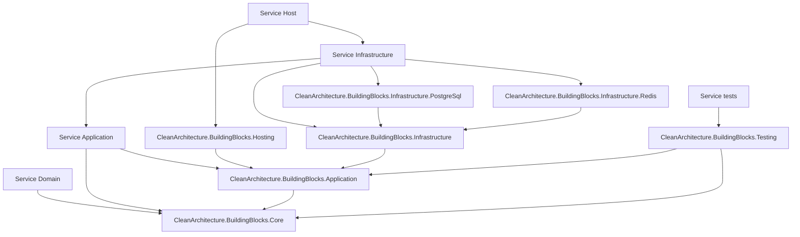

# Clean Architecture Building Blocks evolution

## Status

Phase 00 foundation work. Stages A to C are complete as of 2026-10-28, and Stage E's messaging packages exist with unit and container-based integration tests and are adopted in all five services. Stage E2, added on 2026-10-29 by [ADR-020](../decisions/ADR-020-application-composition-and-cqrs.md), is complete. The [package changelog](../../packages/CleanArchitecture.BuildingBlocks/CHANGELOG.md) records each change. This document defines how Sentinel's `CleanArchitecture.BuildingBlocks` package is built, layered, hardened and eventually extracted into an independently versioned project.

## Decision summary

Build the package as Sentinel's own, generic by design, and keep it small.

- Write the primitives once, in one package, rather than once per service.
- Keep dependency-free domain types apart from application messaging, infrastructure mechanics and host integrations, in separate assemblies from the first version.
- Add an infrastructure layer for the mechanics every service would otherwise re-implement: outbox, inbox, idempotency, transport adapters, options validation and resilience defaults.
- Keep Sentinel-specific concepts in Sentinel.
- Core and Application are in-process. The infrastructure packages adapt existing systems (PostgreSQL, Redis Streams) and never become a message broker, workflow engine, event store or Orleans abstraction.
- Keep package APIs at `0.x` while Sentinel's services expose design gaps.
- Extract to a standalone repository only after its boundaries and compatibility policy are proven by a second consumer.

## What the package provides

The package provides:

- `Result` and `Result<T>` success/failure semantics;
- structured errors and validation errors;
- a simple entity/domain-event pattern;
- command and query contracts;
- in-process command and query dispatchers;
- FluentValidation-based command validation;
- handler logging decorators;
- dependency-registration conventions;
- focused unit tests, and use in all five services, the deploy controller and the scenario runner.

These capabilities directly support the clean internal architecture of each Sentinel service and its shared stable primitives. The package builds on .NET and Microsoft dependency injection, which is coherent with Microsoft Orleans.

## Design hazards the package must avoid

A single assembly that mixes layers is the usual failure of a building-block package: a domain project referencing `Entity` or `Result` would also receive dependency injection, configuration, logging, FluentValidation, Scrutor and a logging provider. The layering below exists to prevent that, and the hardening stage checks the smaller hazards:

- a logging decorator that uses a provider-specific context instead of the `ILogger` it accepts;
- validation that does not pass the caller's cancellation token to validators;
- decorator application that depends on handler-registration order;
- `Entity.DomainEvents` exposing a copied mutable `List` rather than a read-only contract;
- `Raise` and `ClearDomainEvents` as public application surface;
- two overlapping request pipelines without defined roles;
- target framework and dependency versions left implicit;
- tests that do not cover composition order, cancellation, missing handlers, exception behavior or package compatibility.

## Target package architecture



Each service layer references only the building-block layer at the same depth or deeper. A service's domain and application projects never receive an infrastructure package, directly or transitively.

### `CleanArchitecture.BuildingBlocks.Core`

Purpose: dependency-free primitives safe for domain projects.

Initial public surface:

- `Result` and `Result<T>`;
- `Error`, `ErrorType` and `ValidationError` without a validation-framework dependency;
- `IDomainEvent`;
- `Entity` or a more explicit `Entity<TId>` after consumer validation;
- clock abstraction, renamed to `IClock` only by a recorded decision.

Constraints:

- no dependency injection, configuration, HTTP, logging, validation, serialization, persistence, Orleans or telemetry packages;
- no Sentinel concepts;
- no assumptions about database-generated IDs or event storage;
- nullable reference types and analyzers enabled;
- domain events exposed as `IReadOnlyCollection<IDomainEvent>`;
- raising events is protected; clearing them is internal or performed through a deliberate persistence contract.

### `CleanArchitecture.BuildingBlocks.Application`

Purpose: in-process application use-case contracts.

Initial public surface:

- `ICommand` and `ICommand<TResponse>`;
- `IQuery<TResponse>`;
- command/query handler interfaces;
- command/query dispatcher interfaces and implementations;
- `IRequest<TResponse>` and `IRequest`, `IProcessor<TRequest, TResponse>` and `IProcessor<TRequest>`, and `IRequestDispatcher`: the inbound seam. A processor validates one application request, maps it to exactly one command or query and dispatches it, so an HTTP endpoint, a message consumer and a workflow activity for the same use case are thin adapters over one entry point ([ADR-020](../decisions/ADR-020-application-composition-and-cqrs.md));
- framework-neutral pipeline/decorator contracts if they provide clear value;
- the outbox port application handlers use to enqueue integration messages inside the current unit of work. It carries no database or transport types; the infrastructure layer implements it.

Constraints:

- depends only on Core plus the minimum DI abstraction required by the chosen dispatcher implementation;
- commands and queries represent in-process application requests, not integration events or durable messages;
- a request is the application's view of what a caller asked for; it never carries transport types and never crosses a service boundary;
- cancellation tokens flow through every asynchronous operation;
- missing and ambiguous handlers and processors fail with intentional, tested behavior;
- reflection caches must be bounded by application request types and must preserve original exceptions.

`0.1.0-alpha.2` removed `IDto`, `IProcessor` and `IRequestHandler` because they duplicated the command and query pipeline without a defined role. ADR-020 gives them one: they are the only way inbound adapters reach the application layer. They return under the names above, with `IRequest` replacing `IDto` and `IRequestDispatcher` replacing `IRequestHandler` so that "handler" keeps meaning the use case.

### `CleanArchitecture.BuildingBlocks.Infrastructure`

Purpose: technology-neutral infrastructure mechanics that every service would otherwise re-implement.

Initial public surface:

- integration message envelope: message ID, message type, schema version, correlation and causation IDs, occurred-at time and extensible headers;
- outbox dispatcher: a background service that publishes pending outbox records, retrying publish failures with capped exponential backoff. Transport failures are transient, so records are never dropped; the outbox-lag health check reports a backlog;
- inbox handling for idempotent consumers: processed message IDs are recorded and duplicates suppressed;
- an idempotency-key store contract for retried commands;
- publisher and consumer contracts that transport adapters implement;
- integration consumers as inbound adapters: they deserialize a message, pass the inbox check and dispatch an application command, so application code never sees the transport;
- typed options binding with validation at startup;
- resilience defaults for non-HTTP dependencies: timeouts, jittered retry and circuit breaking;
- health checks for outbox lag and consumer lag.

Constraints:

- depends on Core, Application and Microsoft.Extensions abstractions only; no database, broker or vendor SDK;
- contains no Sentinel concepts. Tenant or incident identity travels in envelope headers defined by the consumer;
- implements ports declared in Application, such as the outbox port, rather than exposing infrastructure types to application code;
- no generic repository, ORM wrapper or unit-of-work abstraction;
- HTTP client resilience, service discovery and telemetry export belong to the host's service defaults, not to this package.

### `CleanArchitecture.BuildingBlocks.Infrastructure.PostgreSql`

Purpose: PostgreSQL implementations of the outbox, inbox and idempotency stores.

Constraints:

- stores join the caller's database transaction, so a domain write and its outbox record commit atomically;
- each consuming service keeps these tables in its own database or schema; the package never introduces shared tables;
- table migrations ship with the package and run per service;
- the package shares the caller's connection and transaction, and works under both EF Core and direct Npgsql access ([ADR-009](../decisions/ADR-009-persistence-baseline.md)).

### `CleanArchitecture.BuildingBlocks.Infrastructure.Redis`

Purpose: Redis Streams transport adapter.

Constraints:

- publishes envelopes to streams and consumes through consumer groups with explicit acknowledgment;
- reclaims messages left pending by a crashed consumer after an idle timeout;
- moves a message that exceeds the maximum delivery count to a dead-letter stream with its failure reason;
- applies a configurable stream-trimming policy;
- never uses Redis Pub/Sub for integration messages, because Pub/Sub does not retain messages for offline consumers;
- expects a Redis deployment dedicated to messaging with persistence (AOF) enabled.

Further technology packages, such as another broker, follow the same pattern and are added only when a consumer needs them.

### `CleanArchitecture.BuildingBlocks.Hosting`

Purpose: optional .NET host composition.

Initial public surface:

- service registration extensions: `AddBuildingBlocks(assembly)` registers the dispatchers, every handler, processor and validator in the assembly, and the fixed decorator pipeline;
- `IDependencyModule`, the contract each Application, Infrastructure and Host project implements once to register the types it owns, and a small composer (`AddModules(configuration, params IDependencyModule[])`) that a host's `DependencyContainer` calls in the order Application, Infrastructure, Host;
- validation decorators;
- logging decorators.

Constraints:

- framework integrations remain outside Core and Application contracts;
- use `ILogger.BeginScope` instead of a Serilog-specific context;
- decoration must not silently depend on registration order;
- validation passes cancellation and preserves structured failures;
- registration is idempotent or explicitly rejects duplicate registration; `AddBuildingBlocks` rejects a second call and rejects two handlers or two processors for one message;
- optional integrations should not become transitive dependencies for consumers that do not use them;
- Hosting does not reference the infrastructure packages. Each infrastructure package provides its own registration extension, so a host takes only the integrations it uses;
- a service's Application project may reference Hosting for registration only, because `AddBuildingBlocks` and `IDependencyModule` live here. Application code must not use anything else from Hosting; the architecture tests check that Application types depend only on the `IDependencyModule` and registration namespaces. Domain never references Hosting;
- Hosting stays free of ASP.NET Core. The `Result`-to-HTTP mapping each Sentinel host needs lives in that host until a second consumer needs the same helper, at which point it becomes a separate `Hosting.AspNetCore` package.

### `CleanArchitecture.BuildingBlocks.Testing` — optional

Create only when more than one consumer has concrete use for shared testing helpers.

Possible surface:

- controllable fake clock;
- dispatcher/handler test harness;
- contract assertion helpers;
- dependency-boundary test helpers.

Do not create a generic testing package merely to hold fixtures used by only one product.

## Sentinel ownership boundary

The following must remain Sentinel-owned:

- tenant, environment, service, SLO and incident identifiers;
- canonical observations and provider interfaces;
- evidence, hypotheses, causal graphs and consensus;
- Meta model-provider and agent-tool contracts;
- Orleans grains and grain persistence;
- event-sourced incident state and event envelopes;
- durable workflows, sagas and compensation;
- policy, approvals, capabilities and execution fencing;
- remediation plans, action adapters and recovery verification;
- incident memory, replay scenarios and evaluation data;
- host conventions such as OpenTelemetry resource attributes, health endpoints and service discovery, in the Sentinel-owned `Sentinel.ServiceDefaults` package ([ADR-010](../decisions/ADR-010-local-orchestration.md)).

Generic mechanics such as the outbox, inbox, idempotency store, transport adapters, options validation and resilience defaults may live in the building blocks. Anything that knows about tenants, incidents, evidence, privileged credentials, Orleans or Temporal stays in Sentinel.

The generic `Entity` domain-event collection is not an event-sourcing framework. Sentinel's authoritative incident event stream requires separate versioned events, concurrency rules, replay behavior and schema evolution.

## Message taxonomy

The library and Sentinel must distinguish these concepts:

| Type | Owner | Delivery semantics |
| --- | --- | --- |
| Command/query | Building Blocks Application contract; concrete request owned by Sentinel | In-process, one handler |
| Domain event | Concrete event owned by Sentinel Domain | In-process domain notification unless explicitly persisted |
| Event-sourced event | Sentinel Incident Runtime | Durable, ordered per stream, versioned and replayable |
| Integration event | Concrete event owned by Sentinel Contracts; enqueued through the Application outbox port and delivered by the Infrastructure outbox, transport and inbox | Durable transport, at least once, idempotent consumer |
| Workflow signal | Sentinel Workflows | Durable orchestration semantics |

One marker interface must not be used for all five categories.

## Adoption stages

### Stage A – Package skeleton

1. Record an ADR approving the package and the initial ownership model.
2. Create the package under `packages/` in the Sentinel repository, built from source until extraction.
3. Add explicit target framework, package versions, license and deterministic-build settings.
4. Establish a `0.1.0` prerelease version and changelog.

Location:

```text
packages/
  CleanArchitecture.BuildingBlocks/
    src/
      CleanArchitecture.BuildingBlocks.Core/
      CleanArchitecture.BuildingBlocks.Application/
      CleanArchitecture.BuildingBlocks.Infrastructure/
      CleanArchitecture.BuildingBlocks.Infrastructure.PostgreSql/
      CleanArchitecture.BuildingBlocks.Infrastructure.Redis/
      CleanArchitecture.BuildingBlocks.Hosting/
    tests/
```

### Stage B – Layered assemblies

1. Place types in Core, Application and Hosting assemblies from the first version.
2. Name namespaces for the type's role, `CleanArchitecture.BuildingBlocks.*`, so a type can move between assemblies without consumer edits.
3. Add package-boundary tests proving Domain references Core only.
4. Produce packages and validate their dependency graphs.

### Stage C – Harden

1. Keep logging on `ILogger` scopes, with no provider-specific coupling.
2. Propagate cancellation through validation and dispatch.
3. Make decorator composition deterministic.
4. Restrict domain-event mutation APIs.
5. Keep one request pipeline, with a defined role for every abstraction in it.
6. Define missing-handler, duplicate-handler and exception behavior.
7. Add public API baselines, package compatibility checks and concurrency tests.

### Stage D – Integrate with Sentinel

1. Reference Core from Sentinel Domain.
2. Reference Application from Sentinel Application.
3. Reference Hosting only from composition roots, and the infrastructure packages only from service infrastructure projects and hosts.
4. Build one command and one query through the pipeline.
5. Verify OpenTelemetry spans/log scopes at the host boundary without adding telemetry dependencies to Core.
6. Confirm no Sentinel-specific type is added to the generic packages.

### Stage E – Infrastructure layer

1. Build the infrastructure packages only as far as the walking skeleton needs them. The first cross-service message drives the envelope, outbox, inbox and Redis Streams adapter.
2. Add the PostgreSQL stores with their migrations, and integration tests against real PostgreSQL and Redis containers.
3. Adopt the packages in all five Sentinel services and remove any per-service copies of the same mechanics.
4. Apply the Stage F extraction criteria per package, so an infrastructure package used only by Sentinel stays with Sentinel.

### Stage E2 – Inbound seam, composition and file layout

Added by [ADR-020](../decisions/ADR-020-application-composition-and-cqrs.md). The package must follow the same conventions it asks services to follow, and it must offer the pieces the [composition guide](../architecture/application-composition-and-cqrs.md) relies on.

1. Reinstate `IRequest`, `IProcessor` and `IRequestDispatcher` in Application as described above; scan processors in `AddBuildingBlocks`; extend the duplicate check; add dispatcher tests for missing, duplicate and faulting processors.
2. Add the module composer to Hosting and document the Application-to-Hosting reference rule.
3. One type per file across every package, named for the type. On 2026-10-29 seventeen files hold more than one top-level type, including `Infrastructure/Messaging/Ports.cs` with nine interfaces, `Infrastructure/Configuration/ManagedDocuments.cs` with six, and the two decorator files. Split them with no behavior change and keep namespaces, so consumers recompile without edits.
4. Enable StyleCop rules `SA1402` and `SA1649` for the package at error severity once the split is done; the package is small enough to finish in one change, unlike the services.
5. Record every step in the changelog with a prerelease version bump, and regenerate the public API baselines.

Stage E2 precedes the first service slice in the composition guide because the services cannot adopt the processor seam until the package provides it.

**Status (2026-10-29).** Stage E2 is complete in `0.1.0-alpha.6`, which also renamed the inbound call to `IRequestDispatcher.HandleRequestAsync`. All five services and the reference system's deploy controller and scenario runner compose through `IDependencyModule` and `AddModules` and send every request through the processor seam; the deploy controller's `DeploymentLedger` derives from `Entity`. The reference system is therefore the second, smaller consumer this plan anticipated, and the first that uses the domain-event support, for logging only.

### Stage F – Standalone extraction

Extract the library into its own repository when all criteria below are satisfied:

- a second product besides Sentinel consumes the layered packages; the reference system's deploy controller and scenario runner are a smaller consumer in the same repository under the [ADR-011 amendment](../decisions/ADR-011-reference-system-location.md#internal-composition-amendment-2026-10-29) and count as evidence but not as the second product;
- the public surface has survived at least two real feature cycles;
- ownership and release responsibility are assigned;
- package naming, license and repository metadata are decided;
- CI produces signed or otherwise verifiable packages and a software bill of materials where required;
- compatibility policy and supported target frameworks are documented;
- consumers can upgrade through packages without source-path coupling.

## Versioning and compatibility policy

- Use semantic versioning.
- Stay below `1.0.0` while package boundaries and request abstractions are changing.
- Every public API change updates the changelog and API baseline.
- Breaking prerelease changes require explicit migration notes.
- Do not expose third-party types in Core public APIs.
- Pin package versions centrally and test the packed artifacts, not only project references.
- Choose target frameworks from actual consumer support requirements; do not multi-target speculatively.
- Maintain source and binary compatibility after `1.0.0` unless a major version is intentionally released.

## Required tests

### Core

- success/failure invariants and null behavior;
- error equality and validation-error composition;
- domain-event ordering, read-only exposure and clearing rules;
- API compatibility baseline.

### Application

- command/query dispatch with and without results;
- request dispatch to a processor, with and without results;
- a processor that validates, maps and dispatches exactly once;
- cancellation propagation;
- missing and duplicate handler and processor behavior;
- handler exception preservation;
- concurrent dispatch and invoker-cache behavior;
- scoped lifetime behavior.

### Infrastructure

- a crash between the domain commit and publication: after restart the outbox delivers the message, and the consumer handles it once;
- duplicate delivery: the inbox suppresses the second handling;
- a consumer crash: its pending message is reclaimed and processed by another consumer after the idle timeout;
- a poison message: dead-lettered after the maximum delivery count, with its failure reason;
- options validation fails at startup on missing or invalid configuration;
- integration tests run against real PostgreSQL and Redis containers.

### Hosting

- registration in supported call orders;
- module composition in the documented order, and a module that registers a type outside its layer being caught by the composition test;
- deterministic decorator ordering;
- zero, one and multiple validators;
- cancellation during validation;
- structured log scopes without a concrete logging provider;
- duplicate registration behavior.

### Packaging

- clean restore/build/test from packed artifacts;
- dependency graph assertions for each package;
- reproducible package metadata;
- architecture tests proving each service's domain references Core only, and that no domain or application project receives an infrastructure package transitively.

## Decisions still required

- Whether the package keeps the `CleanArchitecture.BuildingBlocks` name when extracted.
- Whether the clock remains `IDateTimeProvider` or becomes `IClock`.
- Whether `Entity` should be generic over its identifier.
- Whether dispatchers continue using cached reflection or move to generated/compiled invokers.
- Decided by ADR-020: `IDependencyModule` stays in Hosting as the per-layer module contract, composed by a host-owned `DependencyContainer`.
- Whether validation integration belongs in Hosting or a separate optional package.
- Which target frameworks the standalone project will support.
- How the integration envelope is serialized, and how schema versions are negotiated between producer and consumer.
- Whether a maintained library covers Redis Streams consumer groups well enough to wrap, instead of implementing the consumer loop.

These decisions should wait for a second consumer rather than be settled by Sentinel's services alone.

## Phase 00 acceptance criteria

- An ADR records the package decision, ownership and extraction strategy.
- Core, Application, Infrastructure and Hosting dependencies are separated or an approved staged migration is documented.
- Infrastructure packages are separated by technology, and no service's domain or application project references them.
- Each service's domain depends only on Core.
- One integration message travels between two services through the outbox, Redis Streams and the inbox, and a duplicate delivery is suppressed.
- Cancellation, decorator composition and logging-provider coupling are corrected.
- Both command and query paths work in a clean Sentinel build.
- Package tests and Sentinel architecture tests pass.
- A versioned package record exists: version, changelog and API baselines.
- Standalone extraction criteria remain documented and are not treated as already complete.

## Non-goals

- Turning the package into a universal application framework.
- Moving Sentinel domain concepts into generic abstractions.
- Implementing a message broker, workflow engine or event store, or replacing Orleans, durable workflows or event sourcing. The infrastructure packages adapt existing systems.
- A generic repository, ORM wrapper or unit-of-work abstraction.
- Publishing a stable `1.0.0` API before two-consumer evidence exists.
- Creating abstractions without an identified consumer and failure mode.

